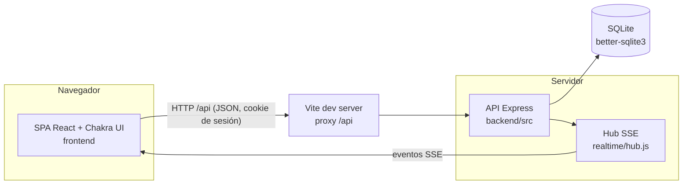
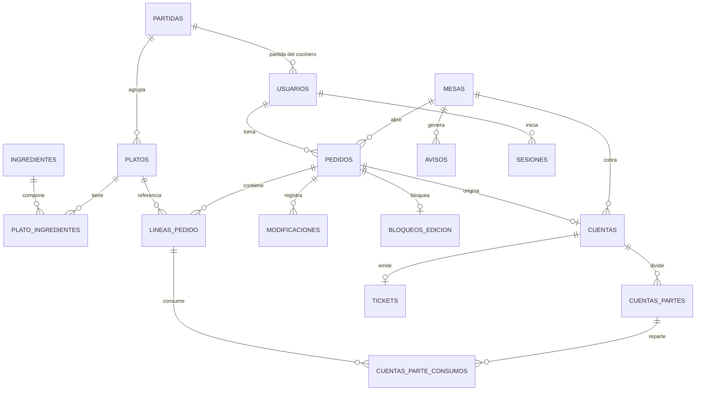

# Memoria del proyecto: Foodware

**Sistema de comandas para restaurante**

Autoría: Israel Izquierdo, Marcos González, Daniel Alarcón y Danil Launov · Fecha de la
memoria: 15 de noviembre de 2026 · Estado del código: rama `develop`, commit `df84244`

---

## Índice

1. [Portada y resumen](#1-portada-y-resumen)
2. [URL del repositorio en GITHUB](#2-url-del-repositorio-en-github)
3. [Introducción](#3-introducción)
4. [Análisis](#4-análisis)
5. [Diseño](#5-diseño)
6. [Implementación](#6-implementación)
7. [Pruebas y validación](#7-pruebas-y-validación)
8. [Despliegue y uso](#8-despliegue-y-uso)
9. [Planificación y seguimiento](#9-planificación-y-seguimiento)
10. [Conclusiones](#10-conclusiones)
11. [Demo](#11-demo)
12. [Anexos](#12-anexos)

---

## 1. Portada y resumen

**Foodware** es una aplicación web para gestionar el servicio de un restaurante: sala,
cocina, cobro y dirección. Cubre el ciclo completo de una comanda, desde que el camarero
abre la mesa y toma el pedido hasta que la cuenta se cierra y se consultan las
estadísticas del servicio, pasando por la preparación en cocina y las señales de platos
listos. **Para quién.** Tiene cuatro roles con permisos distintos: camarero (sala y
cobro), cocinero (pedidos de su partida), encargado (dashboard) y administrador (carta).
**Resultado.** Las nueve especificaciones (la base común `000` y las ocho historias
`001`–`008`) están implementadas en un repositorio JavaScript con React 18 + Chakra UI +
Vite en el frontend y Express + SQLite en el backend, con sesión por cookie y eventos SSE
para tiempo real. A fecha de esta memoria pasan las **503 pruebas automáticas** (342 de
backend en 88 ficheros y 161 de frontend en 43 ficheros), `eslint` está limpio en ambos
paquetes y las **538 tareas** de los nueve `tasks.md` están cerradas.

---

## 2. URL del repositorio en GITHUB

El código fuente de la aplicación está publicado en GitHub:
<https://github.com/ImLecus/foodware>

---

## 3. Introducción

### 3.1 Contexto

Un restaurante trabaja con varias mesas, varias partidas de cocina (entrantes,
principales y postres) y varios camareros. La comunicación entre sala y cocina suele
hacerse de viva voz o en papel, lo que provoca pedidos perdidos, platos que se enfrían y
errores al cobrar. Foodware digitaliza ese circuito en una única aplicación web.

### 3.2 Problema que resuelve

- **Comandas fiables.** El camarero toma el pedido plato a plato, agrupado por partidas, y
  puede editarlo mientras cocina no lo haya bloqueado.
- **Cocina enfocada.** Cada cocinero ve solo lo que le corresponde a su partida, ordenado
  por tiempo de espera, y avanza el estado de cada plato.
- **Sala sincronizada.** Los camareros ven en vivo qué platos están listos, con señal
  visual y sonora, sin recargar la página.
- **Cobro sin errores.** La cuenta se calcula con el precio fijado al pedir y admite cobro
  único, división en partes iguales o por consumo, con ticket final.
- **Dirección con datos.** El encargado consulta ventas del día, desgloses por camarero y
  por plato y comparación con el día anterior.
- **Carta siempre actualizada.** El administrador gestiona platos, precios y
  disponibilidad; si un ingrediente se agota, el plato deja de ofrecerse.

### 3.3 Objetivos

1. Implementar las ocho historias de usuario sobre una base común de identidad, roles y
   modelo de datos.
2. Que cada criterio de éxito sea verificable por una persona no técnica desde la propia
   aplicación.
3. Mantener la solución simple: monolito Express más SPA, sin colas ni microservicios.
4. Interfaz en español de España, importes en euros y formato de fecha español.
5. Una suite de pruebas que proteja las reglas delicadas: bloqueos de edición, división al
   céntimo, disponibilidad combinada y permisos por rol.

### 3.4 Constitución del proyecto

El proyecto se rige por `.specify/memory/constitution.md` (versión 1.2.0, ratificada el
6 de octubre de 2026 y modificada por última vez el 13 de octubre de 2026):

| Principio                                  | Resumen                                              |
| ------------------------------------------ | ---------------------------------------------------- |
| I. Simplicidad ante todo                   | Entre dos soluciones válidas se elige la más simple. |
| II. Idioma y mercado                       | Todo en español de España; moneda en euros.          |
| III. Cero alcance fantasma                 | Solo se implementa lo aprobado en la spec.           |
| IV. Verificable por una persona no técnica | Cada criterio se comprueba desde la interfaz.        |
| V. Datos del usuario con respeto           | Solo datos imprescindibles; sin secretos en el repo. |
| VI. Conventional Commits                   | Todo commit sigue `tipo(alcance): descripción`.      |
| VII. Desarrollo en equipo                  | Entorno reproducible y documentación clara.          |

Además fija la tecnología obligatoria (React + Chakra UI, ExpressJS), el uso de Docker y
un flujo Git Flow con Pull Requests revisados.

---

## 4. Análisis

### 4.1 Actores y roles

| Actor         | Rol en el sistema | Qué puede hacer                                                                                                       |
| ------------- | ----------------- | --------------------------------------------------------------------------------------------------------------------- |
| Camarero      | `camarero`        | Abrir mesa y tomar/editar comandas (001, 002), ver señales de platos listos (005) y cerrar o dividir la cuenta (006). |
| Cocinero      | `cocinero`        | Ver solo los pedidos pendientes de su partida (003) y marcar o deshacer platos listos (004).                          |
| Encargado     | `encargado`       | Consultar el dashboard de estadísticas del servicio (007).                                                            |
| Administrador | `administrador`   | Gestionar la carta, los precios y la disponibilidad de los platos (008).                                              |
| Sistema       | Procesos internos | Publica eventos SSE, calcula la disponibilidad combinada, los totales y la división al céntimo.                       |

Cada usuario tiene un único rol y, si es cocinero, una partida asignada (o ninguna, caso
contemplado en cocina).

### 4.2 Historias de usuario

El enunciado de cada historia procede de la sección _Input_ de su `spec.md`.

| Spec | Historia                                                                                                                       | Prioridades de las subhistorias                                                             |
| ---- | ------------------------------------------------------------------------------------------------------------------------------ | ------------------------------------------------------------------------------------------- |
| 001  | Como **camarero**, quiero abrir una mesa y tomar la comanda plato a plato por partidas, para enviarla a cocina.                | P1 abrir mesa y añadir platos; P1 enviar y anular; P2 trabajar sin conexión                 |
| 002  | Como **camarero**, quiero editar una comanda ya enviada, para corregirla sin perder el pedido original.                        | P1 editar con bloqueo; P1 confirmar cambios; P2 aviso «Modificado»                          |
| 003  | Como **cocinero**, quiero ver solo los pedidos pendientes de mi partida, ordenados por tiempo de espera.                       | P1 lista por partida; P2 detalle y tiempos; P3 actualización en vivo                        |
| 004  | Como **cocinero**, quiero marcar platos como listos para servir, para que sala lo sepa al instante.                            | P1 marcar/deshacer listo; P2 aviso «Pedido completado»; P3 registro                         |
| 005  | Como **camarero**, quiero saber qué platos de cada mesa están listos, con señal visual y sonora.                               | P1 estado en vivo; P1 aviso de mesa completa; P2 descarte global                            |
| 006  | Como **camarero**, quiero cerrar la cuenta y dividirla, para cobrar y emitir el ticket correcto.                               | P1 cobro único; P1 división igual; P1 división por consumo; P2 pago por partes              |
| 007  | Como **encargado**, quiero un dashboard con ventas, desgloses y comparación con días anteriores.                               | P1 total diario; P1 desgloses; P2 comparación                                               |
| 008  | Como **administrador**, quiero gestionar platos, precios y disponibilidad, para que la carta de sala esté siempre actualizada. | P1 catálogo y precios; P1 disponibilidad manual; P1 ingredientes y disponibilidad combinada |

La spec `000` añade la base «de plataforma»: identidad, sesión, roles, modelo de datos
común y datos demo, para que las demás historias no redefinan esas piezas.

### 4.3 Requisitos funcionales

Cada spec numera sus requisitos como `FR-nnn` (con _MUST_). Se resumen por área; el texto
íntegro está en cada `spec.md`.

**Base común (`000`)**

- Un único modelo de datos compartido; ninguna spec redefine una entidad (FR-001).
- Cuatro roles: camarero, cocinero, encargado y administrador (FR-002).
- Login con contraseña, sesión persistente por cookie y logout (FR-003, FR-004).
- Rechazo con motivo comprensible de toda acción que no corresponda al rol (FR-005).
- Datos demo para todos los roles con la misma contraseña (FR-006).

**Valores de negocio** (definidos una sola vez en `backend/src/config` y en las specs)

| Valor                                                     | Cifra                               |
| --------------------------------------------------------- | ----------------------------------- |
| Partidas de cocina                                        | 3: entrantes, principales y postres |
| Minutos de inactividad para liberar el bloqueo de edición | 15                                  |
| Minutos de vigencia de la sesión                          | 720                                 |
| Precio mínimo de un plato                                 | Mayor que 0 (céntimos)              |
| Un pedido en curso por mesa                               | 1 (índice único parcial)            |
| Un ticket por cuenta                                      | 1 (clave única)                     |
| Reparto de la división igual                              | Al céntimo; sobrante de uno en uno  |

**Por historia (selección)**

| Spec              | Requisitos clave                                                                                                                                                                                                   |
| ----------------- | ------------------------------------------------------------------------------------------------------------------------------------------------------------------------------------------------------------------ |
| 001 Comandas      | Abrir mesa libre y crear un pedido en curso; añadir platos por partida con cantidad e indicaciones; anular líneas; enviar a cocina; no permitir dos pedidos en curso en la misma mesa.                             |
| 002 Editar        | Editar un pedido enviado con bloqueo por camarero; liberar el bloqueo por inactividad; registrar cada cambio en `modificaciones`; confirmar los cambios para que cocina los vea; marcar el pedido como modificado. |
| 003 Ver pedidos   | Solo pedidos de la partida del cocinero; orden por `enviado_en` con desempate; tiempo desde el envío original; detalle de platos; actualización por SSE; estados vacío y sin partida.                              |
| 004 Marcar listos | Marcar y deshacer platos listos; reflejo en sala; aviso «Pedido completado» con «Deshacer»; evento SSE por partida.                                                                                                |
| 005 Señales       | Estado de platos por mesa en vivo; aviso visual y sonoro cuando la mesa está completa; descarte global; recálculo al editar comandas enviadas.                                                                     |
| 006 Cuenta        | Cuenta abierta con consumos y total; cobro único; división igual al céntimo; división por consumo; pago y reversión por partes; ticket final único; rechazo con `409`/`422` según estado.                          |
| 007 Dashboard     | Total del último día natural completado; desgloses por camarero y por plato; comparación con el día anterior; fecha visible; sin selector de fechas; atribución al camarero que abrió el pedido.                   |
| 008 Carta         | CRUD de platos e ingredientes; asociación N:M; disponibilidad combinada; baja manual y agotamiento; solo administrador; reflejo inmediato en sala; precio histórico intacto.                                       |

### 4.4 Requisitos no funcionales

| Ámbito               | Requisito                                                                                                     | Fuente                  |
| -------------------- | ------------------------------------------------------------------------------------------------------------- | ----------------------- |
| Rendimiento          | Respuestas de API por debajo de 500 ms; cambios de carta visibles en sala en menos de 3 s.                    | plan de 000, 008 SC-002 |
| Usabilidad en sala   | Tomar una comanda y enviarla sin recargas; cobrar y dividir la cuenta con totales claros.                     | 001, 006                |
| Usabilidad en cocina | Ver la cola por partida y marcar platos listos con un solo gesto; tiempos visibles.                           | 003, 004                |
| Fiabilidad           | Un pedido en curso por mesa; división al céntimo; precio fijado al pedir; un ticket por cuenta.               | 001, 006                |
| Seguridad            | Contraseñas con `scrypt`; cookie de sesión `HttpOnly`; rol releído en cada petición; sin secretos en el repo. | constitución V, 000     |
| Privacidad           | Solo se piden los datos imprescindibles; los informes no exponen datos personales.                            | constitución V, 007     |
| Accesibilidad        | Etiquetas, foco visible y uso por teclado en los componentes interactivos.                                    | plan de 000             |
| Idioma y formato     | Español de España; euros; céntimos en la API; fechas en UTC en la base y `dd/MM/yyyy` en la interfaz.         | constitución II         |
| Compatibilidad       | Navegadores actuales en escritorio y móvil; entorno reproducible con Docker.                                  | plan de 000             |

### 4.5 Reglas que cruzan historias

La parte más delicada del análisis es quién provoca qué cuando una historia afecta a otra.
El flujo central de una comanda es:

1. **001** abre la mesa, crea el pedido en curso y añade las líneas con el precio del
   momento.
2. **001** envía el pedido a cocina y publica `pedido.nuevo`.
3. **002** permite editarlo con bloqueo y, al confirmar, publica `pedido.modificado`.
4. **003** muestra el pedido en la partida correspondiente y **004** marca sus líneas como
   listas; cada cambio publica `linea.actualizada`.
5. **005** refleja en sala el estado de los platos y el aviso de mesa completa.
6. **006** calcula la cuenta con el precio histórico y emite el ticket al cerrar; publica
   `mesa-cerrada`.
7. **007** agrega las cuentas cerradas del último día completado y **008** alimenta la
   carta que consumen 001 y 007.

---

## 5. Diseño

### 5.1 Arquitectura

Monolito con una SPA en un repositorio único. No se usan workspaces ni paquetes
compartidos: el backend y el frontend son independientes y se comunican por HTTP.

```text
foodware/
├── backend/     # Express + SQLite + SSE
├── frontend/    # SPA React + Chakra UI + Vite
├── specs/       # especificaciones Spec Kit (000 a 008)
├── docs/        # agrupamiento y memoria (entrega)
├── docs-historias/  # documentación de las historias
├── .specify/    # constitución y plantillas de Spec Kit
└── docker-compose.yml
```



- **Backend en capas sencillas.** `routes/` y `api/` reciben la petición, `services/` y
  `domain/` aplican las reglas y `models/` y `db/` acceden a SQLite. No hay bus de
  eventos: las llamadas entre módulos son funciones.
- **Frontend por páginas y componentes.** `pages/` contiene las pantallas por rol y
  `components/` los bloques reutilizables; `services/` centraliza el cliente HTTP y SSE.
- **Rutas del front.** `/login`, `/sala`, `/sala/estado`, `/sala/platos`, `/cuentas`,
  `/cocina`, `/dashboard`, `/admin` y `/admin/carta`, protegidas por `RutaProtegida` y el
  rol correspondiente.

### 5.2 Modelo de datos

Definido en `backend/migrations/001_init.sql` y ampliado con migraciones posteriores.
Nombres en español sin tildes; importes en céntimos y fechas en UTC.



Tablas principales:

- **Catálogo**: `partidas`, `platos`, `ingredientes`, `plato_ingredientes`.
- **Sala y pedidos**: `mesas`, `pedidos`, `lineas_pedido`, `modificaciones`,
  `bloqueos_edicion`.
- **Cobro**: `cuentas`, `cuentas_partes`, `cuentas_parte_consumos`, `tickets`.
- **Cocina**: `avisos`.
- **Identidad**: `usuarios`, `sesiones`.

Migraciones: `001_init.sql`, `002-ingredientes.sql`, `002_edicion.sql`,
`003_bloqueo_edicion.sql`, `004_cuentas.sql`, `004_cuentas_camarero.sql`,
`005_indice_cuentas_cierre.sql`, `006_auth.sql`, `007_cuenta_pedido.sql`,
`008_lineas_pedido_indicaciones.sql`, `009_lineas_pedido_instantanea.sql`,
`010_pedidos_cancelada.sql` y `011_modificaciones_cancelar.sql`.

**Restricciones que garantizan las reglas en la propia base de datos**

| Restricción                                                                                              | Regla que protege                                       |
| -------------------------------------------------------------------------------------------------------- | ------------------------------------------------------- |
| Índice único parcial `pedidos_un_en_curso_por_mesa` sobre `pedidos(mesa_id)` donde `estado = 'en_curso'` | Una mesa solo tiene un pedido en curso (001).           |
| Clave única `tickets.cuenta_id`                                                                          | Un único ticket por cuenta (006).                       |
| Clave única `(cuenta_id, orden)` en `cuentas_partes`                                                     | Orden de las partes sin duplicados (006).               |
| `CHECK (precio_centimos > 0)` en `platos` y `lineas_pedido`                                              | Precio siempre positivo (001, 008).                     |
| `CHECK (cantidad > 0)` en `lineas_pedido`                                                                | Cantidad siempre positiva (001).                        |
| `CHECK` de estados en pedidos, líneas, mesas, cuentas, partes, avisos e ingredientes                     | Solo estados previstos por las specs.                   |
| Claves foráneas con `ON DELETE CASCADE` donde procede                                                    | Integridad referencial entre pedidos, líneas y cuentas. |
| Únicos en `mesas.identificador` y `usuarios.id`                                                          | Identificadores sin duplicados.                         |

**Máquinas de estado**

```text
Pedido
(nuevo) ─001→ EN_CURSO ─001→ ENVIADA ─006→ CERRADA
                         └─002→ ENVIADA (con modificaciones)

Línea
PENDIENTE ─004→ LISTO ─004→ PENDIENTE (deshacer)

Cuenta
ABIERTA ─006 (cobro único o última parte)→ CERRADA
ABIERTA ─006 (dividir, pagar, revertir)→ ABIERTA

Ingrediente
DISPONIBLE ─008→ AGOTADO ─008→ DISPONIBLE
```

### 5.3 Contrato de la API

`specs/000-esqueleto-autenticacion/contracts/` fija las convenciones y cada spec detalla
sus rutas.

- Base `/api`, JSON, sesión por cookie; en desarrollo el front accede por el proxy de Vite.
- Importes en céntimos y claves en `snake_case`.
- Un único formato de error con mensaje en español: `{ "error": "…" }` o
  `{ "codigo": "…", "mensaje": "…" }` según el módulo. Códigos HTTP: 400 validación, 401
  sin sesión o credenciales inválidas, 403 rol insuficiente, 404 no existe, 409 conflicto
  de negocio, 422 total desactualizado.
- La identidad se toma de la cookie de sesión; no se aceptan cabeceras de identidad.

| Módulo         | Rutas principales                                                                      | Rol mínimo            |
| -------------- | -------------------------------------------------------------------------------------- | --------------------- |
| auth           | `POST /api/auth/login`, `GET /api/auth/me`, `POST /api/auth/logout`                    | público / cualquiera  |
| salud          | `GET /api/health`                                                                      | público               |
| sala           | `GET /api/mesas`, `POST /api/mesas/:id/abrir`, `GET /api/sala/...`                     | camarero              |
| pedidos        | `POST /api/pedidos`, `POST /api/pedidos/:id/lineas`, `POST /api/pedidos/:id/confirmar` | camarero              |
| cocina         | `GET /api/cocineros/:id`, `GET /api/partidas/:id/pedidos-pendientes`, estados de línea | cocinero              |
| cuentas        | `GET/POST /api/sala/mesas/:id/cuenta...`, `GET .../ticket`                             | camarero              |
| informes       | `GET /api/reports/daily`                                                               | encargado             |
| carta admin    | `GET/POST/PATCH /api/admin/platos`, `GET/POST/PATCH /api/admin/ingredientes`           | administrador         |
| carta consulta | `GET /api/carta`                                                                       | cualquier autenticado |
| eventos        | `GET /api/eventos`, `GET /api/partidas/:id/eventos`                                    | autenticado           |

### 5.4 Decisiones técnicas y por qué se tomaron

Recogidas en los `research.md` de cada spec y en la constitución, con la alternativa
descartada en cada caso.

| #   | Decisión                                                                            | Por qué                                                                      | Alternativa descartada                           |
| --- | ----------------------------------------------------------------------------------- | ---------------------------------------------------------------------------- | ------------------------------------------------ |
| D1  | JavaScript y repositorio único con `backend/` y `frontend/`                         | Simplicidad y arranque rápido para cuatro personas; sin capas ni workspaces. | TypeScript y monorepo con `apps/` y `packages/`. |
| D2  | SQLite con `better-sqlite3`                                                         | Persistencia real sin servidor adicional y pruebas rápidas en memoria.       | PostgreSQL con Prisma.                           |
| D3  | Sesión en cookie `HttpOnly`; contraseñas con `scrypt`; rol releído en cada petición | La baja o el cambio de rol rigen al instante; no hay tokens en el navegador. | JWT o cabecera `x-usuario-id`.                   |
| D4  | SSE en lugar de WebSocket                                                           | Notificaciones unidireccionales suficientes y más simples de operar.         | WebSocket.                                       |
| D5  | Docker Compose con backend y frontend                                               | Todos levantan el mismo entorno con un comando.                              | Instalaciones locales distintas.                 |
| D6  | React + Chakra UI + Vite                                                            | Stack obligatorio de la constitución y componentes accesibles.               | Otra biblioteca de UI o framework.               |
| D7  | Importes en céntimos enteros                                                        | Evita errores de coma flotante en totales y divisiones.                      | Decimales en coma flotante.                      |
| D8  | Migraciones SQL versionadas                                                         | Permiten que varias historias avancen en paralelo sin pisarse.               | Un único esquema editado por todos.              |
| D9  | `createApp(db)` con inyección de la conexión                                        | Pruebas con `':memory:'` y arranque real con el mismo código.                | Conexión global.                                 |
| D10 | Validación con Zod en la API                                                        | Mensajes de error claros y validación uniforme de cuerpos.                   | Validación manual dispersa.                      |

---

## 6. Implementación

### 6.1 Pila tecnológica

| Capa         | Tecnología                                                        |
| ------------ | ----------------------------------------------------------------- |
| Frontend     | React 18, Chakra UI, React Router, Vite, Vitest + Testing Library |
| Backend      | Node.js 22, Express 4, Zod, `better-sqlite3`, Vitest + Supertest  |
| Tiempo real  | Server-Sent Events (SSE)                                          |
| Persistencia | SQLite con migraciones SQL versionadas                            |
| Entorno      | Docker y Docker Compose                                           |
| Calidad      | ESLint y Prettier                                                 |

### 6.2 Estructura del repositorio

Tamaño aproximado del código JavaScript/JSX: backend ~5 100 líneas, frontend ~5 000,
pruebas de backend ~8 300 y pruebas de frontend ~4 500.

```text
backend/
├── migrations/          # 13 migraciones SQL versionadas
├── src/
│   ├── api/             # Routers de carta y reports
│   ├── auth/            # Hash scrypt, cookies y sesiones
│   ├── config/          # Lectura de entorno
│   ├── db/              # Conexión, migraciones y seed
│   ├── domain/          # Reglas de negocio
│   ├── middleware/      # autenticar, authorize, errores, 404
│   ├── models/          # Acceso a datos
│   ├── realtime/        # Hub SSE
│   ├── routes/          # health, auth, sala, cocina, cuentas, eventos
│   ├── schemas/         # Validación Zod
│   ├── services/        # Servicios de aplicación
│   └── utils/
└── tests/{unit,contract,integration,helpers}

frontend/
├── src/
│   ├── auth/            # AuthContext y rutas por rol
│   ├── components/      # Componentes de sala, cocina, carta y UI
│   ├── hooks/           # Hooks de datos y SSE
│   ├── pages/           # Login, sala, cocina, cuentas, dashboard, admin
│   ├── services/        # Cliente HTTP y SSE
│   ├── state/           # Estado compartido
│   ├── theme/           # Tema Chakra (es-ES)
│   └── utils/
└── tests/{components,pages,hooks,services,integration,i18n,utils}

specs/                   # 000-esqueleto y 001…008
docs/                    # agrupamiento.md y memoria.md
docs-historias/          # historias, verificaciones y plantilla
```

### 6.3 Partes más relevantes del código

**a) Disponibilidad combinada de la carta** — `backend/src/services/cartaService.js`:

```js
calcularDisponibilidad(platoId) {
  const plato = this.db.prepare('SELECT * FROM platos WHERE id = ?').get(platoId);
  if (!plato) return { ofrecible: false, motivo: 'no_existe' };
  if (plato.activo !== 1) return { ofrecible: false, motivo: 'inactivo' };
  const ingredientes = this.db
    .prepare(
      `SELECT i.id, i.estado
       FROM plato_ingredientes pi
       JOIN ingredientes i ON i.id = pi.ingrediente_id
       WHERE pi.plato_id = ?`,
    )
    .all(platoId);
  for (const ing of ingredientes) {
    if (ing.estado === 'agotado') {
      return { ofrecible: false, motivo: 'ingrediente_agotado' };
    }
  }
  return { ofrecible: true, motivo: 'activo' };
}
```

Un plato se ofrece solo si está activo y todos sus ingredientes están disponibles; la
baja manual y el agotamiento conviven y el motivo se expone en la API de administración.

**b) Identidad y autorización separadas** — `backend/src/middleware/autenticar.js` y
`authorize.js`. `autenticar(db)` convierte la cookie de sesión en `req.usuario` y renueva
su vigencia; `requireRole(...)` solo comprueba el rol y responde `401` o `403`. Los
routers de administración usan `autenticar(db), requireRole('administrador')`.

**c) División de la cuenta al céntimo** — `backend/src/services/divisionService.js`. El
reparto igual calcula cociente y resto y reparte el sobrante de uno en uno desde la
primera parte; la división por consumo asigna cada línea o un importe de una línea
compartida a cada parte. La suma de partes siempre coincide con el total.

**d) Bloqueo de edición** — `backend/src/domain/` y `bloqueos_edicion`. Un pedido enviado
solo se edita si el camarero tiene el bloqueo vigente; el bloqueo se libera por
inactividad o al confirmar los cambios, y se registra el histórico en `modificaciones`.

**e) Tiempo real** — `backend/src/realtime/hub.js`. Publica eventos como `pedido.nuevo`,
`pedido.pendientes-cambiado`, `linea.actualizada`, `aviso.activo` o `mesa-cerrada` por los
canales SSE global y por partida.

**f) Informe diario** — `backend/src/api/reportsRouter.js`. Agrega las cuentas cerradas
del último día natural completado, atribuye cada cuenta al camarero que abrió el pedido,
incluye camareros activos y platos de la carta vigente aunque no vendan y calcula la
comparación con el día anterior.

**g) Precio histórico** — `lineas_pedido.precio_centimos` guarda el precio en el momento
de pedir. Cambiar la carta no modifica pedidos, cuentas ni informes pasados.

**h) Restricciones en la base de datos** — índice único parcial
`pedidos_un_en_curso_por_mesa`, `CHECK` de estados e importes y claves foráneas. Las
pruebas de integración comprueban que no se puede dejar la base en un estado inválido.

### 6.4 Decisiones tomadas sobre la marcha

- **Convergencia de autenticación (HU08).** La gestión de carta se desarrolló con un
  modelo de cabecera `x-usuario-id` y se adaptó al flujo de cookies de `develop`:
  `autenticar(db) + requireRole('administrador')`, cliente HTTP con
  `credentials: 'include'` y eliminación de la cabecera en el frontend.
- **Precio histórico.** Se conserva el precio fijado al pedir para que los cambios de
  carta no alteren cuentas pasadas.
- **Disponibilidad combinada.** Un plato se ofrece solo si está activo y todos sus
  ingredientes están disponibles; si se repone el ingrediente, vuelve a ofrecerse.
- **Bloqueo de edición.** Se libera por inactividad y al confirmar cambios; el histórico
  queda en `modificaciones`.
- **Atribución en el dashboard.** Se decidió atribuir cada cuenta al camarero que abrió
  o tomó el pedido y, si no consta, al que la cerró.
- **Día del dashboard.** Siempre el último día natural completado anterior a hoy, con la
  fecha visible y sin selector de fechas.
- **Carta sin borrado.** La baja de un plato es `activo = false`; no hay `DELETE`, para
  no romper el histórico de pedidos.
- **Datos demo.** El `seed` calcula el hash de `demo1234` para todos los usuarios, de modo
  que cualquier rol se puede probar sin crear cuentas a mano.

---

## 7. Pruebas y validación

### 7.1 Estrategia

| Nivel       | Herramienta                 | Qué cubre                                                               | Dónde                       |
| ----------- | --------------------------- | ----------------------------------------------------------------------- | --------------------------- |
| Unidad      | Vitest                      | Reglas puras: tiempos, importes, división, disponibilidad, validaciones | `backend/tests/unit`        |
| Contrato    | Vitest + Supertest          | Rutas de la API, códigos de error y permisos por rol                    | `backend/tests/contract`    |
| Integración | Vitest + Supertest + SQLite | Flujos con base de datos, migraciones y eventos                         | `backend/tests/integration` |
| Frontend    | Vitest + Testing Library    | Componentes y páginas, estados de carga/error/vacío                     | `frontend/tests`            |
| Manual      | `quickstart.md`             | Escenarios de extremo a extremo desde la interfaz                       | `specs/*/quickstart.md`     |

Las pruebas se escriben junto al desarrollo de la funcionalidad, como exige la
constitución.

### 7.2 Resultados de las pruebas automáticas

Ejecutadas el 15 de noviembre de 2026 sobre `develop` (`df84244`):

| Suite                                   | Ficheros | Pruebas | Resultado       |
| --------------------------------------- | -------: | ------: | --------------- |
| Backend (unidad, contrato, integración) |       88 |     342 | Todas pasan     |
| Frontend (componentes y páginas)        |       43 |     161 | Todas pasan     |
| **Total**                               |  **131** | **503** | **Todas pasan** |
| `npm run lint`                          |        — |       — | Sin errores     |

### 7.3 Pruebas de concurrencia y de reglas críticas

No hay una suite específica de concurrencia. Las reglas que más riesgo tienen si se
rompen están cubiertas por pruebas de contrato e integración:

- **Un pedido en curso por mesa**: índice único parcial
  `pedidos_un_en_curso_por_mesa` y pruebas de apertura de mesa.
- **Bloqueo de edición**: pruebas de bloqueo, expiración y confirmación de cambios.
- **División al céntimo**: pruebas de reparto igual y por consumo, con sumas que cuadran.
- **Disponibilidad combinada**: pruebas de plato activo, ingrediente agotado y
  restauración.
- **Precio histórico**: prueba de que un cambio de precio no altera líneas ya pedidas.
- **Permisos por rol**: pruebas de contrato con `401`/`403` en las rutas protegidas.
- **Cierre de cuenta**: pruebas de cobro único, pago por partes, reversión y ticket.

### 7.4 Pruebas de extremo a extremo (Playwright)

**No se usa Playwright.** No hay dependencia ni configuración de pruebas E2E en el
repositorio. La cobertura de flujos completos se hace con pruebas de integración de
backend, pruebas de componentes de frontend y los recorridos manuales de los
`quickstart.md`. Queda como trabajo futuro añadir una suite E2E en navegador.

### 7.5 Validación manual

Cada spec incluye un `quickstart.md` con escenarios numerados. Las verificaciones
registradas están en `specs/*/verification.md` y en
`docs-historias/verificacion/`. Existen verificaciones para 000, 003, 004, 006 y 007;
001, 002, 005 y 008 están pendientes de fichero de verificación, aunque sus escenarios
manuales están descritos en el `quickstart.md` correspondiente.

Los recorridos cubren el camino feliz, entradas inválidas y condiciones de permiso o
estado. Los escenarios de carta (E1–E14) están en
[`specs/008-gestion-carta/quickstart.md`](../specs/008-gestion-carta/quickstart.md) y los
del dashboard (E1–E13) en
[`specs/007-dashboard-estadisticas/quickstart.md`](../specs/007-dashboard-estadisticas/quickstart.md).

### 7.6 Rendimiento

No hay scripts de medida de rendimiento en el repositorio, por lo que no se aportan
cifras. Los objetivos documentados son respuestas de API por debajo de 500 ms y reflejo
de cambios de carta en sala en menos de 3 s; se comprueban de forma manual en los
`quickstart.md`.

---

## 8. Despliegue y uso

### 8.1 Requisitos previos

- Docker y Docker Compose, o Node.js 22.
- Puertos libres: `3000` (API) y `5173` (frontend).

### 8.2 Instalación y arranque

```bash
docker compose up --build
docker compose exec backend npm run seed
```

- Frontend: <http://localhost:5173>
- API: <http://localhost:3000/api/health>

Sin Docker:

```bash
cd backend && npm install && npm run seed && npm run dev
cd frontend && npm install && npm run dev
```

Las variables de entorno están documentadas en `.env.example`; `docker-compose.yml`
añade las de sesión.

| Variable                      | Valor de desarrollo                                    |
| ----------------------------- | ------------------------------------------------------ |
| `PORT`                        | `3000`                                                 |
| `DB_PATH`                     | `./data/foodware.db` (Docker: `/app/data/foodware.db`) |
| `CORS_ORIGIN`                 | `http://localhost:5173`                                |
| `BLOQUEO_INACTIVIDAD_MINUTOS` | `15`                                                   |
| `SESSION_TTL_MINUTES`         | `720` (en `docker-compose.yml`)                        |
| `SESSION_COOKIE_SECURE`       | `false` (en `docker-compose.yml`)                      |
| `VITE_API_URL`                | `http://localhost:3000/api`                            |

### 8.3 Comandos útiles

| Comando                         | Qué hace                        |
| ------------------------------- | ------------------------------- |
| `npm run dev`                   | `docker compose up --build`     |
| `npm run down`                  | Detiene los contenedores        |
| `npm test`                      | Pruebas de backend y frontend   |
| `npm run lint`                  | ESLint en ambos paquetes        |
| `npm run format`                | Prettier                        |
| `npm --prefix backend run seed` | Carga datos demo y credenciales |

### 8.4 Integración continua

**No hay integración continua configurada**: el repositorio no incluye
`.github/workflows`. Las comprobaciones se ejecutan en local con `npm test` y
`npm run lint` antes de abrir cada Pull Request. Añadir un flujo de CI es trabajo futuro.

### 8.5 Usuarios de ejemplo

Con el `seed`, todos con la contraseña `demo1234`: `camarero-1` y `camarero-2` (sala y
cuentas), `cocinero-entrantes`, `cocinero-principales`, `cocinero-postres` y
`cocinero-sin-partida` (cocina), `encargado-1` (dashboard) y `admin-1` (gestión de la
carta).

### 8.6 Manual de usuario breve

**Entrar.** Abrir `http://localhost:5173`, ir a `/login` e identificarse con usuario y
contraseña. Tras el login, cada rol ve su menú y sus rutas.

**Como camarero**

1. **Abrir mesa y tomar comanda** (`/sala`): abrir una mesa libre, añadir platos de la
   carta agrupados por partida, indicar cantidades y enviar el pedido a cocina.
2. **Editar una comanda enviada** (`/sala`): añadir, retirar o ajustar líneas mientras no
   haya bloqueo de otro camarero; confirmar los cambios para que cocina los vea.
3. **Señales de platos listos** (`/sala/estado`): ver qué platos están listos por mesa,
   con aviso visual y sonoro cuando la mesa está completa, y descartar el aviso.
4. **Cobrar** (`/cuentas`): revisar el total, cobrar de una vez o dividir la cuenta en
   partes iguales o por consumo, pagar cada parte y obtener el ticket final.

**Como cocinero**

1. **Ver pendientes** (`/cocina`): solo los pedidos de su partida, ordenados por tiempo
   de espera, con el detalle de platos y el aviso «Modificado».
2. **Marcar listos**: marcar o deshacer un plato como listo; el cambio se refleja en sala
   al instante.

**Como encargado**

1. **Dashboard** (`/dashboard`): ver el total del último día completado con su fecha,
   los desgloses por camarero y por plato y la comparación con el día anterior.

**Como administrador**

1. **Gestionar la carta** (`/admin`): crear y editar platos con nombre, partida y precio;
   activar o desactivar su disponibilidad.
2. **Ingredientes**: crear ingredientes y cambiar su estado entre `disponible` y
   `agotado`; asociarlos a platos. Un ingrediente agotado oculta el plato en sala.

---

## 9. Planificación y seguimiento

### 9.1 Método de trabajo

Flujo de Spec Kit por historia:

`specify` → `clarify` → `plan` → `tasks` → `analyze` → `implement` → `converge`

Cada carpeta `specs/NNN-…/` contiene `spec.md`, `plan.md`, `research.md`,
`data-model.md`, `quickstart.md`, `contracts/`, `checklists/` y `tasks.md`. Las
verificaciones están en `verification.md`.

El reparto de historias está en [`docs/AGRUPAMIENTO.md`](./AGRUPAMIENTO.md).

### 9.2 Tareas por especificación

| Spec                            | Tareas hechas | Tareas abiertas | Qué queda abierto |
| ------------------------------- | ------------: | --------------: | ----------------- |
| 000 esqueleto y autenticación   |            51 |               0 | —                 |
| 001 comandas                    |            54 |               0 | —                 |
| 002 editar comanda              |            50 |               0 | —                 |
| 003 ver pedidos                 |            71 |               0 | —                 |
| 004 marcar listos               |            67 |               0 | —                 |
| 005 señales de platos listos    |            72 |               0 | —                 |
| 006 cierre y división de cuenta |            44 |               0 | —                 |
| 007 dashboard                   |            58 |               0 | —                 |
| 008 gestión de la carta         |            71 |               0 | —                 |
| **Total**                       |       **538** |           **0** | —                 |

### 9.3 Iteraciones

El historial tiene **451 commits** entre el 6 de octubre y el 3 de noviembre de 2026. Las
iteraciones principales, reconstruidas a partir de los merges y Pull Requests, fueron:

| Fecha        | Iteración            | Contenido                                                                         |
| ------------ | -------------------- | --------------------------------------------------------------------------------- |
| 6–13 oct     | Base y sala          | Esqueleto, Docker, autenticación y roles; abrir mesa (001) y editar comanda (002) |
| 13–20 oct    | Cocina               | Ver pedidos (003), marcar listos (004) y señales en sala (005)                    |
| 20–27 oct    | Cobro y dirección    | Cierre y división de cuenta (006) y dashboard (007)                               |
| 27 oct–3 nov | Carta y refinamiento | Gestión de la carta (008), convergencia de auth, correcciones cruzadas y pruebas  |

### 9.4 Historial de commits

- **451 commits** con mensajes en Conventional Commits (`feat`, `fix`, `docs`, `test`,
  `chore`), repartidos entre los cuatro integrantes.
- Autores principales del historial: `iis8-ua`, `Marcos`, `Danil Launov Draganov`,
  `dam55`, `Israel Izquierdo Sanchís` y `Daniel Alarcón Mena`.
- Ramas por historia fusionadas en `develop` mediante Pull Request.

### 9.5 Issues y pull requests

Se han fusionado las **PR #1–#15** hacia `develop`, entre ellas:

- #1 abrir mesa, #2 editar comanda, #3 ver pedidos, #4 marcar listos.
- #6 señales, #7 dashboard, #9 cierre de cuenta.
- #11 historia 000, #13 gestión de la carta.
- #15 correcciones finales de la iteración.

No se han usado issues de GitHub como seguimiento; el trabajo se ha trazado con las
tareas de `tasks.md`, las ramas y los Pull Requests.

---

## 10. Conclusiones

### 10.1 Qué se consiguió

- Una aplicación funcional que cubre las ocho historias y la base común.
- Una arquitectura sencilla y reproducible con Docker Compose.
- Una suite de **503 pruebas automáticas** y lint limpio.
- Documentación de spec, plan, tareas y verificación para cada historia.
- Un flujo de autenticación unificado por cookies y roles.

### 10.2 Problemas encontrados

- **Convergencia de autenticación**: la HU08 se desarrolló con un modelo de cabecera y
  hubo que adaptarla al modelo de cookies de `develop`.
- **Conflictos de merge**: `app.js`, `authorize.js` y `App.jsx` concentraron los roces
  entre historias.
- **Datos locales**: la base de datos de desarrollo necesitó el `seed` para tener
  credenciales demo.
- **Validación manual pendiente**: algunos `quickstart.md` no tienen todavía su fichero de
  verificación con evidencias.

### 10.3 Trabajo futuro

- Migrar los tests de contrato de carta al flujo de cookies con `supertest.agent`.
- Eliminar la duplicidad heredada de `backend/db/` (`schema.sql` y `seed.js`).
- Añadir pruebas de extremo a extremo con Playwright.
- Configurar integración continua en GitHub Actions.
- Completar la validación manual cronometrada y los ficheros de verificación de 001,
  002, 005 y 008.

---

## 11. Demo

La demo se entrega aparte en `DemoSSD_GXX.zip`:

- `demo/index.html`: página para ver la demo completa o por historia y escenario.
- `demo/datos.js`: manifiesto de historias, escenarios y tiempos.
- `demo/video/`: vídeos `.mp4` y pósteres `.jpg`.

<!-- TODO: enlazar aquí la demo publicada o indicar cómo abrir demo/index.html. -->

---

## 12. Anexos

### 12.1 Repositorio

<https://github.com/ImLecus/foodware>

### 12.2 Especificaciones completas

| Documento                       | Ubicación                                                                                   |
| ------------------------------- | ------------------------------------------------------------------------------------------- |
| 000 esqueleto y autenticación   | [`specs/000-esqueleto-autenticacion/spec.md`](../specs/000-esqueleto-autenticacion/spec.md) |
| 001 comandas                    | [`specs/001-comandas/spec.md`](../specs/001-comandas/spec.md)                               |
| 002 editar comanda              | [`specs/002-editar-comanda/spec.md`](../specs/002-editar-comanda/spec.md)                   |
| 003 ver pedidos                 | [`specs/003-ver_pedidos/spec.md`](../specs/003-ver_pedidos/spec.md)                         |
| 004 marcar listos               | [`specs/004-marcar_listos/spec.md`](../specs/004-marcar_listos/spec.md)                     |
| 005 señales de platos listos    | [`specs/005-senales-platos-listos/spec.md`](../specs/005-senales-platos-listos/spec.md)     |
| 006 cierre y división de cuenta | [`specs/006-cierre-cuenta-division/spec.md`](../specs/006-cierre-cuenta-division/spec.md)   |
| 007 dashboard                   | [`specs/007-dashboard-estadisticas/spec.md`](../specs/007-dashboard-estadisticas/spec.md)   |
| 008 gestión de la carta         | [`specs/008-gestion-carta/spec.md`](../specs/008-gestion-carta/spec.md)                     |
| Validación manual               | `specs/*/quickstart.md` y `specs/*/verification.md`                                         |

### 12.3 Glosario

| Término            | Significado                                                             |
| ------------------ | ----------------------------------------------------------------------- |
| Comanda / pedido   | Conjunto de líneas de platos de una mesa.                               |
| Partida            | Bloque de cocina (entrantes, principales, postres).                     |
| Línea              | Un plato con cantidad y precio dentro de un pedido.                     |
| Señal              | Aviso visual o sonoro de que un plato está listo.                       |
| Parte              | Cada porción de una cuenta dividida.                                    |
| Carta vigente      | Platos que se ofrecen en sala (activos y con ingredientes disponibles). |
| SSE                | Server-Sent Events, canal de notificaciones en tiempo real.             |
| Bloqueo de edición | Reserva temporal de un pedido enviado por un camarero.                  |
