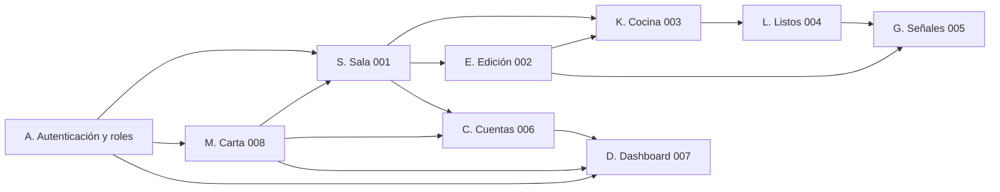

# Vídeo funcional de Foodware — inventario de casos y caminos

> Documento de planificación previo al guion definitivo y a la grabación.
>
> Objetivo: enumerar **todos los casos observables** de la aplicación, ordenarlos por
> dependencias y repartirlos en caminos para que **ningún caso se grabe dos veces** (salvo
> transiciones técnicas inevitables, que no se narran de nuevo).

---

## 0. Cómo leer este documento

### 0.1. Identificadores

Cada caso tiene un identificador estable:

| Prefijo | Módulo | Spec |
| --- | --- | --- |
| `A` | Autenticación, sesión, roles y navegación global | 000 |
| `S` | Sala: abrir mesa y tomar pedido | 001 |
| `E` | Editar pedido enviado | 002 |
| `K` | Cocina: ver pedidos pendientes | 003 |
| `L` | Cocina: marcar platos listos | 004 |
| `G` | Sala: señales de platos listos | 005 |
| `C` | Cierre y división de cuenta | 006 |
| `D` | Dashboard de estadísticas | 007 |
| `M` | Gestión de la carta | 008 |
| `T` | Casos técnicos transversales | 000 y base |

### 0.2. Tipo de caso

| Etiqueta | Significado |
| --- | --- |
| `Cámara` | Se graba y se explica en el vídeo. |
| `Breve` | Se graba en un plano corto, b-roll o timelapse. |
| `Paralelo` | Necesita dos ventanas, dos perfiles de navegador o dos pantallas a la vez. |
| `Offline` | Necesita cortar la red o detener el backend. |
| `Fixture` | Necesita una copia de la base de datos o un estado de datos distinto. |
| `API` | Se verifica con `curl`, pruebas automatizadas o terminal; no se graba, o solo se muestra una captura. |

### 0.3. Camino asignado

Cada caso aparece en **un único camino** de la sección 5:

- `A`: autenticación y servicio principal de una mesa.
- `B`: cobros, divisiones y reutilización de mesas.
- `C`: administración de la carta.
- `D`: dashboard.
- `E`: casos especiales (paralelo, offline, caducidades, fixtures).
- `F`: API y comprobaciones técnicas fuera de cámara.

La regla es: **un caso, un camino, una escena**. Cuando una misma acción alimenta dos
casos de módulos distintos (por ejemplo, aumentar la cantidad de una línea ya lista
alimenta `E-19` y `G-18`), se graba una sola vez y en la matriz se indica que esa escena
cubre ambos casos.

---

## 1. Resumen ejecutivo

- Hay **más de 200 casos** inventariados entre funcionalidades, errores, estados vacíos,
  concurrencia, pérdida de conexión y comprobaciones de API.
- La mayor parte se puede cubrir con **un solo estado de datos**: el seed actual.
- Los casos que no caben en ese estado se concentran en:
  - dashboard sin historial o sin ventas;
  - atribución de una cuenta a otro camarero;
  - cuenta dividida dentro del dashboard;
  - caducidad de sesión y caducidad del bloqueo de edición;
  - estados vacíos globales;
  - errores de carga y cortes de red.
- Esos casos van al **camino E** con copias de la base de datos o configuración corta.
- Los casos de API van al **camino F** y no deben mezclarse con la narración funcional.
- **Antes de grabar hay que corregir o neutralizar tres detalles del seed** (pedidos
  históricos que aparecen en cocina, duplicidad de la Mesa 2 y snapshots de líneas
  históricas). Están detallados en la sección 2.4.

---

## 2. Escenario base, datos y preparación

### 2.1. Usuarios demo

Contraseña para todos: `demo1234`.

| Usuario | Rol | Partida | Uso en el vídeo |
| --- | --- | --- | --- |
| `camarero-1` | camarero | — | Protagonista de sala, cuentas y edición. |
| `camarero-2` | camarero | — | Segundo camarero para bloqueos y descarte global. |
| `cocinero-entrantes` | cocinero | entrantes | Primera parada de cocina. |
| `cocinero-principales` | cocinero | principales | Segunda parada de cocina. |
| `cocinero-postres` | cocinero | postres | Tercera parada y cierre de mesa completa. |
| `cocinero-sin-partida` | cocinero | — | Caso `A-14`, cocina sin partida. |
| `encargado-1` | encargado | — | Dashboard. |
| `admin-1` | administrador | — | Gestión de la carta. |

### 2.2. Mapa de mesas y estado del seed

El seed deja **Mesa 1 a Mesa 9 ocupadas** con pedidos enviados y **Mesa 10 a Mesa 20
libres**. Además crea cuentas históricas de anteayer y ayer para el dashboard.

| Mesa | Estado inicial | Uso previsto | Casos principales |
| --- | --- | --- | --- |
| Mesa 1 | Ocupada con `pedido-demo-1` | Cocina y señales de apoyo | `K-03`, `K-18`, `G-11` |
| Mesa 2 | Ocupada con `pedido-enviado-1` y `pedido-demo-2` | Ejemplo de edición del seed y apoyo | `S-04`, `E-01` |
| Mesa 3 | Ocupada con `pedido-demo-3` modificado | Aviso «Modificado» | `K-09`, `K-05` |
| Mesa 4 | Ocupada con `pedido-demo-4` | Completar, aviso y cancelar pedido | `E-16`, `G-20`, `K-20` |
| Mesa 5 | Ocupada con `pedido-demo-5` | Cocina con línea lista y pendiente | `K-08`, `L-17` |
| Mesa 6 | Ocupada con `pedido-demo-6` | Espera de más de una hora | `K-18` |
| Mesa 7 | Ocupada con `pedido-demo-7` | Empate de envío | `K-04` |
| Mesa 8 | Ocupada con `pedido-demo-8` | Empate de envío | `K-04` |
| Mesa 9 | Ocupada con `pedido-reutilizado` | Un solo plato, aviso y división igual | `K-19`, `G-12`, `C-12` |
| Mesa 10 | Libre | Flujo principal completo | `S-*`, `K-*`, `L-*`, `G-*`, `E-*`, `C-08` |
| Mesa 11 | Libre | Reserva / plan B | — |
| Mesa 12 | Libre | Cuenta a cero y división por consumo | `C-07`, `C-14`, `C-15` |
| Mesa 13 | Libre | Cambio de total tras división, si se graba | `C-22` |
| Mesa 14 | Libre | Partes pagadas, si se graba | `C-23` |
| Mesa 15 | Libre | Anular pedido en curso | `S-16` |
| Mesa 16 a 20 | Libres | Reserva | — |

### 2.3. Datos históricos del dashboard

Con el seed actual, el dashboard muestra el **último día natural completado anterior a
hoy** y estas cifras comprobadas:

| Dato | Valor |
| --- | --- |
| Fecha mostrada | `16/11/2026` (último día completado) |
| Total vendido | `89,00 €` |
| Cuentas cerradas | `3` |
| Total del día anterior | `25,00 €` |
| Diferencia | `+64,00 €` |
| Porcentaje | `+256,00 %` con el código actual |
| Ventas por camarero | Ana `53,00 €` y 2 cuentas; Luis `36,00 €` y 1 cuenta |
| Platos con ventas | Entrecot `22,00 €`; Ensalada `21,00 €`; Paella `18,00 €`; Croquetas `17,00 €`; Tarta `6,00 €`; Helado `5,00 €` |
| Platos a cero | Flan `0,00 €`; Merluza `0,00 €` |
| Comparación por camarero | Ana sube `28,00 €`; Luis sube `36,00 €` con «sin base de comparación» |
| Comparación por plato | Merluza baja `-16,50 €`; Flan sin variación; varios platos con «sin base de comparación» |

Estas cifras permiten enseñar **subida, bajada, sin variación y «sin base de
comparación»** en una sola pantalla, sin preparar datos extra.

### 2.4. Preparación imprescindible antes de grabar

Estos puntos se han detectado revisando el seed y el código. Si no se corrigen, el vídeo
mostrará comportamientos confusos o contrarios a la especificación.

1. **Pedidos históricos visibles en cocina.** El seed inserta los pedidos históricos
   (`pedido-historico-1`, `-2`, `-3`, `-4`) con estado `enviada` y líneas pendientes. La
   cocina los lista como pedidos pendientes de hace uno o dos días y rompe el orden por
   antigüedad. Antes de grabar hay que marcarlos como `cerrada` (o `cancelada`) para que
   no aparezcan en cocina. El dashboard no se ve afectado porque agrega cuentas cerradas.
2. **Mesa 2 con dos pedidos enviados.** El seed crea `pedido-enviado-1` y
   `pedido-demo-2` en la misma Mesa 2. En cocina aparecen dos pedidos de Mesa 2. Para el
   vídeo conviene dejar solo uno de los dos, mover uno a otra mesa o marcar uno como
   cerrado. La opción más limpia es usar `pedido-enviado-1` como ejemplo de edición y
   retirar `pedido-demo-2` del estado de grabación.
3. **Snapshots de líneas históricas.** Las líneas de los pedidos históricos no guardan
   `nombre_plato` ni `partida_codigo`; el sistema cae al nombre actual del plato. Si en el
   vídeo se cambia el nombre o la partida de un plato del seed, el pedido histórico y el
   dashboard podrían mostrar el dato nuevo. Para demostrar el histórico, usar un pedido
   **creado durante la grabación** (las líneas nuevas sí guardan la instantánea).
4. **Signo `+` en el porcentaje de subida.** La interfaz muestra `+256,00 %` en las
   subidas, mientras que la especificación pide que las subidas no lleven signo positivo.
   Decidir antes de grabar: mostrar el comportamiento actual o corregirlo. Si se corrige,
   el guion debe decir `256,00 %`.
5. **Validación de precio en administración.** El formulario de plato devuelve
   silenciosamente si el precio está vacío o es menor o igual que cero: no muestra el
   aviso que pide la especificación. Para el vídeo, o se corrige, o el caso `M-03` se
   enseña por API en el camino F.
6. **«Cobrar cuenta» en un pedido en curso.** La pantalla de sala muestra el botón
   «Cobrar cuenta» también para pedidos `en_curso`. La cuenta resultante puede cerrarse
   sin haber enviado el pedido a cocina. No es un caso previsto por las historias. **No
   pulsar ese botón en el vídeo** hasta que el pedido esté enviado; si se quiere enseñar,
   hacerlo como incidencia en el camino F, no como funcionalidad.
7. **Etiqueta visible del control de sonido.** El botón del aviso muestra «Sonido
   activado» o «Sonido desactivado», mientras que su `aria-label` dice «Silenciar
   sonido» o «Activar sonido». En la grabación, señalar el control por su función, no por
   el texto literal.
8. **Ruta `/sala/platos`.** Existe y muestra el estado de los platos de una mesa, pero no
   está en el menú. Se puede enseñar por URL directa como pantalla de apoyo de la
   historia 004.

### 2.5. Comandos de preparación y copias

```bash
# Arranque limpio
docker compose up --build -d

# Datos demo
docker compose exec backend npm run seed

# Reset de la base de datos (parar antes el backend)
rm -f backend/data/foodware.db
docker compose exec backend npm run seed
```

Para trabajar con estados alternativos, hacer copias del fichero SQLite con el backend
parado:

```bash
docker compose stop backend
cp backend/data/foodware.db /tmp/opencode/foodware-W0.db   # estado inicial
cp backend/data/foodware.db /tmp/opencode/foodware-W1.db   # tras el camino A
docker compose start backend
```

Restaurar una copia:

```bash
docker compose stop backend
cp /tmp/opencode/foodware-W0.db backend/data/foodware.db
docker compose start backend
```

### 2.6. Perfiles de navegador

La sesión vive en una cookie `HttpOnly`; **no se puede tener dos roles en la misma
ventana**. Para los casos en paralelo hacen falta perfiles o contenedores distintos:

| Perfil | Usuario | Uso |
| --- | --- | --- |
| `P1` | `camarero-1` | Ventana principal de sala. |
| `P2` | `camarero-2` | Bloqueo de edición, descarte global, doble sesión. |
| `P3` | `cocinero-entrantes` | Cocina. |
| `P4` | `cocinero-principales` | Cocina. |
| `P5` | `cocinero-postres` | Cocina. |
| `P6` | `encargado-1` | Dashboard. |
| `P7` | `admin-1` | Carta. |

Recomendación: Chrome con perfiles separados o Firefox con contenedores. Las ventanas
incógnito también sirven, pero se pierden al cerrarlas.

---

## 3. Inventario completo de casos

> En las tablas siguientes, «Resultado esperado» describe lo que debe verse en pantalla o
> lo que debe devolver la API. Los textos entre comillas son los literales de la interfaz
> actual.

### 3.1. Autenticación, sesión, roles y navegación global (`A`)

| ID | Caso | Resultado esperado | Tipo | Camino |
| --- | --- | --- | --- | --- |
| A-01 | Entrar sin sesión en cualquier URL protegida | Redirección a `/login`; no se muestran datos. | Cámara | A |
| A-02 | Enviar el formulario con usuario o contraseña vacíos | El navegador bloquea el envío por `required`; no hay petición. | Cámara | A |
| A-03 | Login con usuario inexistente | `Usuario o contraseña incorrectos`; no se crea sesión. | Cámara | A |
| A-04 | Login con contraseña incorrecta | Mismo mensaje genérico que A-03; no se revela si el usuario existe. | Cámara | A |
| A-05 | Login correcto de `camarero-1` | Entra en `/sala`; cabecera con nombre, rol y menú Sala, Señales y Cuentas. | Cámara | A |
| A-06 | Login correcto de un cocinero | Entra en `/cocina`; menú solo Cocina. | Cámara | A |
| A-07 | Login correcto de `encargado-1` | Entra en `/dashboard`; menú Dashboard. | Cámara | A |
| A-08 | Login correcto de `admin-1` | Entra en `/admin`; menú Carta. | Cámara | A |
| A-09 | Recargar la página con sesión iniciada | La sesión continúa; no vuelve al login. | Cámara | A |
| A-10 | Pulsar «Cerrar sesión» | Vuelve a `/login`; la sesión actual queda invalidada. | Cámara | A |
| A-11 | Abrir una URL protegida después del logout | Redirección a `/login`; no se muestran datos. | Cámara | A |
| A-12 | Abrir por URL un módulo de otro rol | «Acceso denegado» y «No tienes permisos para acceder a esta sección». | Cámara | A |
| A-13 | Revisar el menú de cada rol | Solo aparecen los módulos permitidos por la matriz de acceso. | Cámara | A |
| A-14 | Login de `cocinero-sin-partida` y apertura de `/cocina` | «No tienes una partida asignada»; no permite marcar platos. | Cámara | E |
| A-15 | Dejar caducar la sesión por inactividad y operar | La operación devuelve `401`; la aplicación vuelve a `/login` y pide acceso. | Fixture | E |
| A-16 | Varias sesiones del mismo usuario | Se permiten; cerrar una no invalida la otra. | Paralelo | E |
| A-17 | Reiniciar el backend con sesiones válidas | Las sesiones siguen siendo válidas hasta su caducidad o logout. | API | F |
| A-18 | Llamar a una API sin sesión o con rol incorrecto | `401` sin sesión; `403` con rol no autorizado; los canales SSE igual. | API | F |
| A-19 | Escritura con `Origin` no permitido | `403` antes de ejecutar la operación. | API | F |
| A-20 | Revisar almacenamiento de contraseñas y credenciales demo | Hash no reversible; nunca se devuelven ni se registran en claro. | API | F |
| A-21 | Abrir una ruta inexistente | «Página no encontrada». | Cámara | A |
| A-22 | Abrir `/login` estando ya autenticado | Redirección al inicio del rol. | Breve | A |

### 3.2. Sala: abrir mesa y tomar pedido (`S`, spec 001)

| ID | Caso | Resultado esperado | Tipo | Camino |
| --- | --- | --- | --- | --- |
| S-01 | Seleccionar una mesa libre | Aparece el botón `Abrir Mesa N`. | Cámara | A |
| S-02 | Abrir una mesa libre | La mesa pasa a ocupada y se crea un pedido `en_curso`; mensaje de éxito. | Cámara | A |
| S-03 | Intentar abrir dos veces la misma mesa o crear un segundo pedido en curso | La interfaz ya no ofrece abrir; la API responde `409` sin duplicar. | API | F |
| S-04 | Seleccionar una mesa ocupada con pedido enviado | Se muestra la comanda con sus líneas y el botón «Editar pedido». | Cámara | A |
| S-05 | Añadir un plato con cantidad 1 | La línea aparece en el pedido; el total se actualiza. | Cámara | A |
| S-06 | Añadir un plato con cantidad mayor que 1 | Se guarda la cantidad indicada. | Cámara | A |
| S-07 | Añadir una indicación a un plato | La nota se muestra bajo el nombre del plato. | Cámara | A |
| S-08 | Repetir el mismo plato | Se permiten líneas repetidas del mismo plato. | Cámara | A |
| S-09 | Revisar el pedido con platos de varias partidas | Agrupación automática en Entrantes, Principales y Postres; las partidas vacías muestran «Sin platos». | Cámara | A |
| S-10 | Ajustar la cantidad antes de confirmar | El pedido refleja la nueva cantidad y el total. | Cámara | A |
| S-11 | Retirar una línea antes de confirmar | La línea desaparece y el total se recalcula. | Cámara | A |
| S-12 | Revisar el total | Suma en euros con formato español y dos decimales. | Cámara | A |
| S-13 | Intentar confirmar un pedido sin platos | «Confirmar pedido» deshabilitado; la API responde `409` si se fuerza. | Cámara | A |
| S-14 | Confirmar el pedido | Pasa a `enviada`; mensaje «Pedido confirmado y enviado a cocina»; se publica el evento SSE. | Cámara | A |
| S-15 | Consultar el pedido después de confirmar | Sigue vinculado a la misma mesa, marcado como Enviada. | Cámara | A |
| S-16 | Anular un pedido en curso | Diálogo de confirmación; «Volver» no cambia nada; «Sí, anular pedido» descarta el pedido, libera la mesa y no envía nada a cocina. | Cámara | A |
| S-17 | Abrir sala sin mesas cargadas o sin mesas visibles | Aviso de seed o «No hay mesas para mostrar». | Fixture | E |
| S-18 | Perder la conexión durante la toma del pedido | Aviso «Sin conexión»; no se puede confirmar ni modificar; lo anotado se conserva; al volver se recupera. | Offline | E |
| S-19 | Cambiar nombre, partida o precio de un plato ya pedido desde administración | La línea conserva el nombre, la partida y el precio del momento de pedir. | Cámara | C |
| S-20 | Seleccionar una mesa libre sin abrirla | Panel «Sin pedido abierto»; la carta no permite añadir. | Breve | A |
| S-21 | Pulsar «Cobrar cuenta» con un pedido todavía en curso | Incidencia: la cuenta puede cerrarse sin enviar el pedido a cocina. No mostrar como flujo correcto. | API | F |

### 3.3. Editar un pedido enviado (`E`, spec 002)

| ID | Caso | Resultado esperado | Tipo | Camino |
| --- | --- | --- | --- | --- |
| E-01 | Ver el botón «Editar pedido» | Solo aparece en pedidos `enviada` y con conexión. | Cámara | A |
| E-02 | Entrar al editor de un pedido enviado | Se toma el bloqueo de edición; no hay paso previo de «reabrir». | Cámara | A |
| E-03 | Añadir un plato nuevo a un pedido enviado | El plato se incorpora al mismo pedido, no se crea otro. | Cámara | A |
| E-04 | Retirar un plato de un pedido enviado | Desaparece del pedido vigente. | Cámara | A |
| E-05 | Ajustar la cantidad de una línea | El pedido refleja la nueva cantidad. | Cámara | A |
| E-06 | Corregir las indicaciones de una línea | La nota actualizada se muestra en el pedido y en cocina. | Cámara | A |
| E-07 | Intentar retirar la última línea | El botón «Quitar» está deshabilitado; la API rechaza dejar el pedido vacío. | Cámara | A |
| E-08 | Editar un pedido enviado | Aparecen los distintivos «Modificada» y «Cambios pendientes». | Cámara | A |
| E-09 | Revisar la acción de envío antes de pulsarla | «Enviar cambios» está deshabilitado sin cambios; los cambios no se comunican solos. | Cámara | A |
| E-10 | Pulsar «Enviar cambios» | Cocina recibe el pedido marcado como «Modificado», conservando tiempo y posición originales. | Cámara | A |
| E-11 | Cancelar o salir del editor sin cambios | El bloqueo se libera y el pedido no queda marcado como modificado. | Cámara | A |
| E-12 | Pulsar «Enviar cambios» | El bloqueo se libera y otro camarero puede abrir el pedido. | Cámara | A |
| E-13 | Intentar editar un pedido bloqueado por otro camarero | «El pedido está bloqueado por otro camarero»; `423 pedido_bloqueado`. | Paralelo | A |
| E-14 | Dejar expirar el bloqueo por inactividad e intentar guardar | `409 bloqueo_expirado`; aparece «Reabrir edición» y al pulsarlo se recupera el bloqueo. | Fixture | E |
| E-15 | Editar un pedido cerrado o cancelado | La API rechaza la operación; la interfaz no ofrece editar. | API | F |
| E-16 | Cancelar el pedido completo ya enviado | Diálogo; «Sí, cancelar pedido» lo retira de cocina y sala, libera la mesa y no genera cobro. | Cámara | A |
| E-17 | Editar un pedido con otra comanda en la mesa | No aplica con el modelo actual: una mesa tiene una comanda activa. Verificar por API. | API | F |
| E-18 | Marcar o desmarcar un plato desde cocina mientras el pedido está bloqueado | La operación se rechaza; al liberar el bloqueo, cocina trabaja sobre el estado resultante. | Paralelo | A |
| E-19 | Cambiar la cantidad de una línea ya lista | Si baja o se mantiene, sigue lista; si sube, vuelve a pendiente y se borra el momento de listo. | Cámara | A |
| E-20 | Editar o cancelar un pedido con una parte de cuenta pagada | `409 partes_pagadas`; hay que deshacer el pago y dejar las partes pendientes. | Paralelo | B |
| E-21 | Perder la conexión dentro del editor | Aviso «Sin conexión»; no se guarda ni se envía; lo escrito se conserva. | Offline | E |
| E-22 | Consultar la trazabilidad de una modificación | Registro con tipo, momento y usuario; cocina solo muestra «Modificado». | API | F |
| E-23 | Comprobar que la edición no duplica el pedido | Sigue siendo un único pedido vinculado a la misma mesa. | Cámara | A |
| E-24 | Abrir el editor sin cambios y salir | No aparece «Modificada» ni «Cambios pendientes». | Cámara | A |
| E-25 | Intentar editar un pedido después de cerrar su cuenta | La API responde `409`; la interfaz no muestra la acción. | API | F |

### 3.4. Cocina: ver pedidos pendientes (`K`, spec 003)

| ID | Caso | Resultado esperado | Tipo | Camino |
| --- | --- | --- | --- | --- |
| K-01 | Abrir `/cocina` como cocinero | Solo se muestran pedidos de su partida. | Cámara | A |
| K-02 | Revisar la lista de pendientes | Solo aparecen pedidos con al menos una línea pendiente de su partida. | Cámara | A |
| K-03 | Comparar dos pedidos con distinta antigüedad | El más antiguo aparece primero; el más reciente al final. | Cámara | A |
| K-04 | Dos pedidos con el mismo instante de envío | Se ordenan por identificador creciente, sin cambios arbitrarios. | Cámara | A |
| K-05 | Observar el tiempo de espera | Se calcula desde el envío original y avanza con el reloj local. | Cámara | A |
| K-06 | Identificar la mesa de cada pedido | Cada tarjeta muestra «Mesa N». | Cámara | A |
| K-07 | Revisar los platos de un pedido | Aparecen todos los platos y cantidades. | Cámara | A |
| K-08 | Distinguir platos listos y pendientes | Color más etiqueta textual `listo` o `pendiente`, nunca solo color. | Cámara | A |
| K-09 | Revisar un pedido modificado | Aviso «Modificado» junto al pedido; tiempo y posición originales. | Cámara | A |
| K-10 | Partida sin pedidos pendientes | Estado vacío «No hay pedidos pendientes». | Fixture | E |
| K-11 | Primera carga de la vista | Indicador de carga «Cargando pedidos…» antes de la lista o el estado vacío. | Breve | A |
| K-12 | Fallo de la carga inicial | «No se pudieron cargar los pedidos» con botón «Reintentar»; no se muestra el estado vacío. | Offline | E |
| K-13 | Cocinero sin partida | «No tienes una partida asignada»; no permite marcar platos. | Cámara | E |
| K-14 | Llegada de un pedido nuevo desde sala | Aparece sin recargar, en la posición que le corresponde. | Cámara | A |
| K-15 | Un pedido deja de estar pendiente | Desaparece de la lista y el resto se reordena. | Cámara | A |
| K-16 | Cambio de estado de una línea | La lista de cocina se refresca sin recargar. | Cámara | A |
| K-17 | Perder la conexión con la vista abierta | Aviso «Sin conexión»; la información se marca como no actualizada; el tiempo sigue avanzando; al reconectar se refresca. | Offline | E |
| K-18 | Pedido con más de una hora de espera | El tiempo se muestra de forma legible, sin desbordarse. | Cámara | A |
| K-19 | Pedido con un único plato | Se muestra igual que cualquier otro. | Cámara | A |
| K-20 | Pedido cancelado desde sala | Desaparece de cocina; no se marca ni se cuenta como completado. | Cámara | A |
| K-21 | Todos los platos de la partida marcados como listos | El pedido desaparece de la lista de esa partida. | Cámara | A |
| K-22 | Muchos pedidos pendientes | La lista permite desplazarse y localizar el más urgente. | Breve | A |
| K-23 | Marcar un plato de otra partida | La API responde `403`; la interfaz no ofrece la acción. | API | F |
| K-24 | Acceder a la API de otra partida | `403`; la identidad y la partida salen de la sesión, no de la URL. | API | F |
| K-25 | Línea de otra partida dentro de la tarjeta | Se ve, pero no tiene acción de marcado. | Cámara | A |
| K-26 | Marcar un plato de un pedido que ya no está pendiente | La API rechaza la operación; el estado no cambia. | API | F |

### 3.5. Cocina: marcar platos listos (`L`, spec 004)

| ID | Caso | Resultado esperado | Tipo | Camino |
| --- | --- | --- | --- | --- |
| L-01 | Marcar un plato como listo | La línea completa queda `listo`; se registra el momento. | Cámara | A |
| L-02 | Marcar un plato de un pedido con varios platos | Solo cambia esa línea; las demás siguen pendientes. | Cámara | A |
| L-03 | Revisar un pedido con líneas listas y pendientes | El pedido sigue en la lista hasta completar todas las líneas de la partida. | Cámara | A |
| L-04 | Marcar la última línea pendiente de la partida | El pedido desaparece de la lista y aparece el aviso «Pedido completado» durante 10 segundos. | Cámara | A |
| L-05 | Pulsar «Deshacer» en el aviso temporal | El plato vuelve a pendiente y el pedido reaparece en la lista. | Cámara | A |
| L-06 | Volver a marcar el plato | El pedido se completa de nuevo. | Cámara | A |
| L-07 | Deshacer la marca desde la lista de un plato listo | El plato vuelve a pendiente y se recalcula la completitud. | Cámara | A |
| L-08 | Marcar una línea con varias unidades | Todas las unidades de la línea quedan listas a la vez. | Cámara | A |
| L-09 | Volver a marcar un plato ya listo | No cambia el estado ni el momento registrado. | API | F |
| L-10 | Marcar una línea retirada de un pedido | Ya no existe como pendiente; la API rechaza la operación. | API | F |
| L-11 | Marcar un plato de un pedido cancelado | La API rechaza; el pedido ya no está en cocina. | API | F |
| L-12 | Marcar mientras el pedido está bloqueado por edición | La API rechaza hasta liberar el bloqueo. Se cubre en E-18. | Paralelo | A |
| L-13 | Marcar sin conexión | La acción está deshabilitada o falla; no se registran marcas parciales. Se cubre en K-17. | Offline | E |
| L-14 | Consultar el momento de preparación | «Preparado a las HH:MM»; se conserva al volver a marcar. | Cámara | A |
| L-15 | Marcar desde dos pantallas a la vez | El resultado es único; no se duplica el momento registrado. | Paralelo | E |
| L-16 | Plato no disponible en la carta pero ya en un pedido enviado | Sigue en el pedido y se puede marcar como listo. | Cámara | C |
| L-17 | Mesa con todos los platos enviados listos | Se genera la señal de mesa completa. Se cubre en G-04. | Cámara | A |
| L-18 | Pedido con una línea lista y otras pendientes | Se muestran todas y se distingue su estado. | Cámara | A |

### 3.6. Sala: señales de platos listos (`G`, spec 005)

| ID | Caso | Resultado esperado | Tipo | Camino |
| --- | --- | --- | --- | --- |
| G-01 | Abrir `/sala/estado` | Se listan las mesas abiertas con los platos de la comanda enviada; los pedidos en curso no cuentan. | Cámara | A |
| G-02 | Revisar una mesa con platos pendientes y listos | Cada plato muestra su estado de forma inequívoca. | Cámara | A |
| G-03 | Marcar un plato en cocina con la vista abierta | El estado cambia sin recargar ni volver a abrir la mesa. | Cámara | A |
| G-04 | Completar todos los platos enviados de una mesa | Aparece un aviso visual de mesa completa. | Cámara | A |
| G-05 | Identificar el aviso | El aviso muestra el nombre de la mesa. | Cámara | A |
| G-06 | Dejar pasar el tiempo sin descartar | El aviso sigue visible; no se repite solo. | Cámara | A |
| G-07 | Completar la mesa con sonido activado | Suena un pitido una sola vez. | Cámara | A |
| G-08 | Silenciar y reactivar el sonido | El control cambia; la preferencia persiste al recargar; la señal visual no desaparece. | Cámara | A |
| G-09 | Descartar el aviso con dos camareros conectados | El aviso desaparece en todas las pantallas. | Paralelo | A |
| G-10 | Revisar tras descartar | No reaparece hasta que se marque un nuevo plato como listo en esa mesa. | Cámara | A |
| G-11 | Varias mesas completas a la vez | Cada aviso identifica su mesa de forma independiente. | Cámara | A |
| G-12 | Mesa con un único plato enviado | Al estar listo, la mesa se considera completa y genera aviso. | Cámara | A |
| G-13 | Mesa con solo pedido en curso | Aparece como abierta, sin platos que cocina pueda marcar y sin aviso. | Cámara | A |
| G-14 | Vista sin mesas abiertas | «No hay mesas abiertas». | Fixture | E |
| G-15 | Carga inicial de la vista | Indicador de carga, no pantalla en blanco. | Breve | A |
| G-16 | Perder y recuperar la conexión | Aviso «Sin conexión»; información no actualizada; al volver se resincronizan estados y avisos. | Offline | E |
| G-17 | Editar una comanda completa y añadir un plato pendiente | El aviso se retira; al marcar el plato nuevo como listo se genera un aviso nuevo. | Cámara | A |
| G-18 | Subir la cantidad de una línea ya lista | Vuelve a pendiente, se borra su momento de listo y el aviso se retira. | Cámara | A |
| G-19 | Cerrar la cuenta de una mesa con aviso activo | El aviso se retira y la mesa desaparece de la vista. | Cámara | B |
| G-20 | Cancelar el pedido completo de una mesa con aviso activo | El aviso y la mesa desaparecen de la vista; no se cobra. | Cámara | A |
| G-21 | Aviso sin atender durante mucho tiempo | No vuelve a sonar ni desaparece solo; la señal visual sigue. | Cámara | A |
| G-22 | Deshacer un plato listo con la mesa completa | El aviso se retira y la mesa deja de considerarse completa. | Cámara | A |
| G-23 | Abrir `/sala/platos?mesa=...` | Estado de los platos de la mesa, actualizado por SSE. | Breve | A |
| G-24 | Descartar un aviso que ya no existe | La API responde `404`; la vista lo quita localmente. | API | F |
| G-25 | Descartar sin conexión | La acción está deshabilitada; el aviso se conserva. | Offline | E |

### 3.7. Cierre y división de cuenta (`C`, spec 006)

| ID | Caso | Resultado esperado | Tipo | Camino |
| --- | --- | --- | --- | --- |
| C-01 | Abrir `/cuentas` sin mesa | Lista de mesas abiertas con pedido para cobrar. | Cámara | B |
| C-02 | Abrir `/cuentas` sin mesas abiertas | «No hay mesas abiertas para cobrar». | Fixture | E |
| C-03 | Revisar la cuenta de una mesa | Consumos con el precio fijado al pedir y total en euros. | Cámara | B |
| C-04 | Pulsar «Cancelar» antes de cobrar | Vuelve a la selección; la cuenta y la mesa quedan como estaban. | Cámara | B |
| C-05 | Intentar cobrar con platos pendientes en cocina | Aviso con los platos pendientes; «Confirmar cobro único» deshabilitado. | Cámara | B |
| C-06 | Marcar los platos pendientes como listos y reintentar | El aviso desaparece y el cierre se permite. | Cámara | B |
| C-07 | Abrir la cuenta de una mesa sin consumos | Total `0,00 €`; no se permite cerrar; mensaje explicativo. | Cámara | B |
| C-08 | Cobro único | Ticket con el total; la cuenta se cierra y la mesa queda libre. | Cámara | B |
| C-09 | Volver a consultar el ticket de una cuenta cerrada | Se muestra el ticket final sin permitir operaciones. | Cámara | B |
| C-10 | Intentar pagar o cerrar una cuenta ya cerrada | `409`; no se generan tickets ni pagos duplicados. | API | F |
| C-11 | Reutilizar una mesa liberada | Se puede abrir una nueva comanda; la cuenta anterior sigue como histórico. | Cámara | B |
| C-12 | Dividir en partes iguales | Se reparte el total y la suma de las partes coincide. | Cámara | B |
| C-13 | Reparto con céntimos sobrantes | El sobrante se reparte de uno en uno desde la primera parte. | Cámara | B |
| C-14 | Dividir por consumo | Cada plato se asigna a una parte. | Cámara | B |
| C-15 | Plato compartido entre varias partes | Su importe se reparte entre las partes seleccionadas sin perder la suma total. | Cámara | B |
| C-16 | Revisar las etiquetas de las partes | «Parte 1», «Parte 2»…; no se piden nombres ni datos personales. | Cámara | B |
| C-17 | Confirmar la división | Se muestran las partes y sus importes; no se cierra la mesa. | Cámara | B |
| C-18 | Marcar partes como pagadas | Cada parte se paga por separado; la mesa sigue ocupada y no hay ticket hasta la última. | Cámara | B |
| C-19 | Deshacer el pago de una parte | Vuelve a pendiente mientras la cuenta esté abierta; no se emite ticket. | Cámara | B |
| C-20 | Pagar la última parte | Se emite un único ticket con el desglose; la mesa queda libre. | Cámara | B |
| C-21 | Intentar ver el ticket antes de la última parte | «No se emitirá el ticket hasta pagar la última parte de la cuenta». | Cámara | B |
| C-22 | Modificar la cuenta después de confirmar la división y pagar | `422 total_desactualizado`; la división se descarta y hay que rehacerla. | Paralelo | E |
| C-23 | Editar o cancelar el pedido con una parte pagada | `409 partes_pagadas`; hay que deshacer el pago; después la división se reinicia. | Paralelo | B |
| C-24 | Dividir en una sola parte | Es válido: una parte con el total; se puede cobrar como división. | Breve | B |
| C-25 | Intentar confirmar una parte con importe cero | «Cada parte debe tener un importe mayor que cero.» | Cámara | B |
| C-26 | Dejar el comensal vacío | La API o la interfaz rechazan la división. En la UI actual el nombre no es editable; verificar por API. | API | F |
| C-27 | Perder la conexión durante el cobro o la división | No se permite cerrar, dividir, pagar ni deshacer; lo compuesto se conserva; al volver se continúa. | Offline | E |
| C-28 | Pedir el ticket antes de que exista | `409 ticket_no_emitido`. | API | F |
| C-29 | Cerrar una mesa con `/sala/estado` abierto | La mesa y su aviso desaparecen por el evento `mesa-cerrada`. | Cámara | B |
| C-30 | Cancelar un pedido antes de cobrar | El pedido cancelado no forma parte del consumo; no hay cuenta ni cobro. | Cámara | A |
| C-31 | Cambiar el precio de un plato ya pedido | La cuenta usa el precio fijado al pedir. Se cubre en S-19. | Cámara | C |
| C-32 | Cuenta dividida en el dashboard | Cuenta una sola vez por el total, atribuida al camarero que abrió el pedido. | Fixture | E |
| C-33 | Fallo al cargar las mesas de `/cuentas` | Aviso de error y opción de reintentar; no se muestra una lista vacía falsa. | Offline | E |
| C-34 | Pulsar «Cobrar cuenta» desde un pedido en curso | Incidencia detectada; no es un flujo previsto. No pulsar en el vídeo. | API | F |

### 3.8. Dashboard (`D`, spec 007)

| ID | Caso | Resultado esperado | Tipo | Camino |
| --- | --- | --- | --- | --- |
| D-01 | Abrir `/dashboard` como encargado | Carga el informe del último día completado. | Cámara | D |
| D-02 | Abrir `/dashboard` con otro rol | Acceso denegado; la API responde `403`. | Cámara | D |
| D-03 | Revisar el total | Muestra el total del último día natural completado anterior a hoy. | Cámara | D |
| D-04 | Revisar la fecha | Fecha visible en formato español junto al total. | Cámara | D |
| D-05 | Revisar el número de cuentas | Indica cuántas cuentas cerradas componen el dato. | Cámara | D |
| D-06 | Consultar un día sin ventas | Total `0,00 €` y aviso de que no hay ventas registradas. | Fixture | E |
| D-07 | Revisar ventas por camarero | Todos los camareros activos, incluidos los que no vendieron (`0,00 €`). | Cámara | D |
| D-08 | Revisar el orden por camarero | Importe descendente; a igualdad, nombre alfabético. | Cámara | D |
| D-09 | Revisar ventas por plato | Todos los platos de la carta vigente, incluidos los no vendidos (`0` unidades y `0,00 €`). | Cámara | D |
| D-10 | Revisar el orden por plato | Importe descendente; a igualdad, nombre alfabético. | Cámara | D |
| D-11 | Revisar la comparación total | Diferencia en euros y porcentaje con dos decimales. | Cámara | D |
| D-12 | Revisar la tendencia | Subida, bajada o sin variación con texto e icono, no solo color. | Cámara | D |
| D-13 | Día anterior sin ventas pero con historial | Diferencia en euros y «sin base de comparación»; sin porcentaje. | Fixture | E |
| D-14 | Sin ninguna cuenta anterior | «Sin datos anteriores para comparar». | Fixture | E |
| D-15 | Comparación por camarero | Unión de ambos días, con `0,00 €` donde no vendió y «sin base» cuando corresponda. | Cámara | D |
| D-16 | Comparación por plato | Unión de ambos días, con `0,00 €` y «sin base» cuando corresponda. | Cámara | D |
| D-17 | Cuenta abierta por un camarero y cerrada por otro | Se atribuye al que abrió o tomó el pedido; solo si no consta, al que cerró. | Fixture | E |
| D-18 | Cuenta dividida | Cuenta una sola vez por el total; las partes no se suman por separado. | Fixture | E |
| D-19 | Plato vendido y luego renombrado o cambiado de partida | El dashboard conserva nombre y partida del momento de pedir. | Fixture | E |
| D-20 | Cerrar cuentas hoy y abrir el dashboard | Sigue mostrando el último día completado anterior; hoy no aparece hasta que termine. | Cámara | D |
| D-21 | Primera carga | Indicador de carga. | Breve | D |
| D-22 | Error del servidor | Mensaje de error real, no «sin conexión». | Fixture | E |
| D-23 | Sin conexión | Aviso «Sin conexión. No se ha podido cargar el informe del día.». | Offline | E |
| D-24 | API con `date` inválido, hoy o futuro | `400`; el día en curso no está completado. | API | F |
| D-25 | API sin `date` | Usa el último día natural completado. | API | F |
| D-26 | Revisar formatos | Euros y porcentajes con coma decimal y formato español. | Cámara | D |
| D-27 | Camarero o plato con ventas solo el día anterior y ya inactivo o fuera de carta | Debe aparecer en la comparación con `0,00 €` en el día actual; revisar el comportamiento actual. | Fixture | E |

### 3.9. Gestión de la carta (`M`, spec 008)

| ID | Caso | Resultado esperado | Tipo | Camino |
| --- | --- | --- | --- | --- |
| M-01 | Abrir `/admin` como administrador | Tabla con todos los platos, incluidos los no ofrecibles, y su disponibilidad. | Cámara | C |
| M-02 | Crear un plato con nombre, partida y precio válidos | Aparece en la tabla y en la carta de sala. | Cámara | C |
| M-03 | Crear o editar con precio vacío, cero o negativo | Debe rechazarse con aviso y conservar el último valor válido. La UI actual no muestra aviso; verificar por API. | API | F |
| M-04 | Asignar una partida no válida | El sistema la rechaza; la interfaz solo ofrece las tres partidas fijas. | API | F |
| M-05 | Crear un plato sin ingredientes | Se ofrece si está manualmente activo. | Cámara | C |
| M-06 | Editar nombre, partida o precio de un plato | La tabla y la carta vigente reflejan el cambio. | Cámara | C |
| M-07 | Cambiar el precio de un plato ya pedido | Solo afecta a nuevos pedidos; la línea y la cuenta conservan el precio anterior. | Cámara | C |
| M-08 | Desactivar manualmente un plato | Deja de ofrecerse en sala; en administración aparece como «Desactivado». | Cámara | C |
| M-09 | Reactivar un plato | Vuelve a ofrecerse en sala. | Cámara | C |
| M-10 | Crear un ingrediente | Aparece en el panel con estado `disponible`. | Cámara | C |
| M-11 | Editar nombre o estado de un ingrediente | El panel refleja el cambio. | Cámara | C |
| M-12 | Marcar un ingrediente como agotado | Todos los platos asociados dejan de ofrecerse con motivo «Ingrediente agotado». | Cámara | C |
| M-13 | Reponer el ingrediente | Los platos asociados vuelven a ofrecerse si siguen activos. | Cámara | C |
| M-14 | Disponibilidad combinada: plato desactivado e ingrediente agotado | Al reponer el ingrediente, el plato sigue oculto hasta reactivarlo manualmente. | Cámara | C |
| M-15 | Asociar ingredientes a un plato y guardar | Se sustituye el conjunto completo de ingredientes del plato. | Cámara | C |
| M-16 | Plato con varios ingredientes: uno agotado | El plato deja de ofrecerse. | Cámara | C |
| M-17 | Ingrediente asociado a varios platos | Al agotarse se ocultan todos; al reponerse vuelven según su estado manual. | Cámara | C |
| M-18 | Cambiar precio o disponibilidad con sala abierta | La carta de sala se actualiza sin recargar. | Cámara | C |
| M-19 | Cambiar la carta con pedidos ya enviados | Los pedidos y cuentas pasadas no se alteran. | Cámara | C |
| M-20 | Crear dos platos con el mismo nombre | Se permiten si son platos distintos; la identidad es el plato, no el nombre. | Breve | C |
| M-21 | Acceder a `/admin` con otro rol | Acceso denegado; la API de administración responde `403`. | Cámara | C |
| M-22 | Enviar estado de ingrediente inválido, nombre vacío o ingrediente inexistente | `400` con aviso; no se aplica el cambio. | API | F |
| M-23 | Perder la conexión al guardar un cambio | Aviso de error; no se aplica; se conserva lo escrito. | Offline | E |
| M-24 | Fallo al cargar platos o ingredientes | Mensaje de error; no se muestra una tabla vacía como si no hubiera datos. | Offline | E |
| M-25 | Revisar la tabla de administración | Columnas de activo, ofrecible y motivo correctos. | Cámara | C |
| M-26 | Revisar precios | Euros con formato español. | Cámara | C |
| M-27 | Plato ya vendido | No se elimina; se desactiva para conservar el histórico. | Cámara | C |
| M-28 | Cambiar nombre o partida de un plato ya pedido | El pedido conserva la instantánea del momento de pedir. | Cámara | C |
| M-29 | Cambiar la partida de un plato | La carta vigente lo agrupa en la nueva partida; las líneas pasadas no cambian. | Breve | C |
| M-30 | Asociar un ingrediente inexistente | `400`; no se modifica el plato. | API | F |

### 3.10. Casos técnicos transversales (`T`)

| ID | Caso | Resultado esperado | Tipo | Camino |
| --- | --- | --- | --- | --- |
| T-01 | `GET /api/health` | Estado del servicio y comprobación de la base de datos. | API | F |
| T-02 | Arranque con base de datos nueva | Se aplican todas las migraciones versionadas. | API | F |
| T-03 | Ejecutar el seed | Carga partidas, usuarios, mesas, carta, ingredientes, pedidos y cuentas de ejemplo. | API | F |
| T-04 | Canales SSE | Exigen sesión y rol; no aceptan identidad por URL. | API | F |
| T-05 | Escrituras con origen no permitido | `403`; no se ejecuta la operación. | API | F |
| T-06 | Contraseñas | Hash no reversible; no se registran ni se devuelven. | API | F |
| T-07 | Caducidad de sesión configurable | `SESSION_TTL_MINUTES`; sin secretos en código. | API | F |
| T-08 | Pruebas automatizadas | Backend y frontend en verde con `npm test`. | API | F |
| T-09 | Arranque reproducible | `docker compose up --build` deja frontend y API disponibles. | API | F |
| T-10 | Histórico y snapshots | Las líneas conservan nombre, partida y precio del momento de pedir. | API | F |
| T-11 | Rendimiento del dashboard | Carga en menos de 3 segundos con datos representativos. | API | F |
| T-12 | Accesibilidad de estados | Los estados no dependen solo del color; hay etiquetas y textos. | Breve | A |

---

## 4. Análisis de dependencias

### 4.1. Grafo general



### 4.2. Dependencias de estado

| Caso o grupo | Necesita antes | Produce después |
| --- | --- | --- |
| Abrir mesa y confirmar pedido (`S-01` a `S-15`) | Mesa libre; camarero con sesión. | Pedido `enviada` visible en cocina y señales. |
| Cocina y listos (`K`, `L`) | Pedido enviado. | Líneas listas; pedido desaparece de la partida. |
| Señales (`G`) | Pedido enviado y platos marcados. | Aviso de mesa completa; descarte global. |
| Edición (`E`) | Pedido enviado. | Pedido modificado, nuevas líneas, cambios comunicados. |
| Cobro (`C`) | Pedido enviado; sin platos pendientes para cerrar. | Cuenta cerrada, ticket, mesa libre. |
| Reutilización (`C-11`) | Cuenta cerrada y mesa libre. | Nueva comanda sobre la misma mesa. |
| Dashboard (`D`) | Cuentas cerradas de días completados. | Informe del último día completado. |
| Carta (`M`) | Sesión de administrador. | Carta vigente actualizada; impacta a sala, cuentas y dashboard. |
| Bloqueo de edición (`E-13`, `E-18`) | Dos camareros o camarero y cocina a la vez. | Mensaje de bloqueo; liberación al enviar o cancelar. |
| Partes pagadas (`E-20`, `C-23`) | División confirmada y una parte pagada. | Edición bloqueada; hay que deshacer el pago. |
| Cambio de total (`C-22`) | División confirmada sin pagos y edición posterior. | `422`; división descartada. |

### 4.3. Estados mutuamente excluyentes

Estos casos **no pueden convivir en la misma base de datos** y deben grabarse en copias
distintas:

| Grupo | Estado A | Estado B |
| --- | --- | --- |
| Dashboard con historial | Ayer y anteayer con ventas (seed). | Sin cuentas anteriores. |
| Dashboard con ventas | Total mayor que cero. | Día sin ventas. |
| Dashboard con base de comparación | Día anterior con ventas. | Día anterior con historial pero sin ventas. |
| Atribución de cuenta | Cuenta abierta y cerrada por el mismo camarero. | Abierta por uno y cerrada por otro. |
| Cuenta dividida en dashboard | Cuenta normal. | Cuenta dividida cerrada en un día completado. |
| Bloqueo expirado | `BLOQUEO_INACTIVIDAD_MINUTOS=15`. | `BLOQUEO_INACTIVIDAD_MINUTOS=1`. |
| Sesión caducada | `SESSION_TTL_MINUTES=720`. | `SESSION_TTL_MINUTES=1`. |
| Cocina sin partida | Cocinero con partida. | `cocinero-sin-partida`. |
| Estados vacíos | Seed con 20 mesas y 9 pedidos. | Base sin pedidos o sin mesas abiertas. |

### 4.4. Reglas para no repetir casos

1. **Una sola grabación de login incorrecto**: camino A, escena A1. En el resto del
   vídeo, los cambios de rol son transiciones, no se vuelve a explicar el error.
2. **Una sola grabación de «marcar listo»**: se explica con la Mesa 10 y se reutiliza en
   timelapse para el resto de partidas. Los casos `L-01` a `L-08` se cubren en esa
   secuencia.
3. **Una sola grabación de aviso de mesa completa**: se usa la Mesa 10. La Mesa 9 cubre
   la variante de un único plato (`G-12`) y la Mesa 4 la variante de cancelación
   (`G-20`). No se repite la explicación del pitido.
4. **Una sola grabación de división igual**: Mesa 9. La división por consumo se graba una
   vez en la Mesa 12. El pago por partes se explica en la Mesa 9 y en la Mesa 12 solo se
   repite en timelapse.
5. **Una sola grabación de cobro único**: Mesa 10. No se vuelve a explicar en las mesas
   de división.
6. **Los casos de API** no se mezclan con la narración: van al camino F con capturas de
   terminal o se omiten del vídeo.
7. **Los estados vacíos y errores de carga** se agrupan en un único bloque de fallos
   técnicos (camino E) en lugar de repetirlos en cada módulo.

---

## 5. Caminos de casos

### Camino A — Autenticación y servicio principal de una mesa

**Objetivo narrativo:** entrar en la aplicación, abrir una mesa, tomar y confirmar el
pedido, pasar por cocina, marcar platos listos, ver las señales en sala, editar el pedido
enviado y cancelar otra comanda.

**Duración estimada:** 12–18 minutos.

**Precondición:** base recién sembrada, sin sesión, perfiles P1 y P3–P5 disponibles.

| Escena | Acción | Casos cubiertos | Resultado en pantalla |
| --- | --- | --- | --- |
| A1.1 | Abrir `/sala` sin sesión | A-01 | Redirección a `/login`. |
| A1.2 | Enviar login vacío | A-02 | El navegador no envía; los campos siguen requeridos. |
| A1.3 | Login con usuario inexistente | A-03 | Mensaje genérico; no hay sesión. |
| A1.4 | Login con contraseña incorrecta | A-04 | Mismo mensaje genérico. |
| A1.5 | Login correcto `camarero-1` | A-05, A-13 | Entra en Sala; menú correcto. |
| A1.6 | Recargar la página | A-09 | La sesión continúa. |
| A1.7 | Abrir `/dashboard` por URL | A-12 | «Acceso denegado». |
| A1.8 | Cerrar sesión | A-10 | Vuelve a `/login`. |
| A1.9 | Abrir `/sala` de nuevo | A-11 | Vuelve a `/login`. |
| A1.10 | Probar `/login` estando dentro | A-22 | Redirige al inicio del rol. |
| A1.11 | Abrir una ruta inexistente | A-21 | «Página no encontrada». |
| A1.12 | Matriz de roles: cocinero, encargado y administrador | A-06, A-07, A-08, A-13 | Cada uno entra en su pantalla y ve su menú. Se hace en plano rápido y se cierra sesión. |
| A1.13 | Volver a entrar como `camarero-1` | — | Estado listo para el servicio. |
| A2.1 | Seleccionar Mesa 2 (ocupada) | S-04 | Se muestra la comanda enviada y «Editar pedido». |
| A2.2 | Seleccionar Mesa 10 (libre) | S-01, S-20 | Botón «Abrir Mesa 10»; panel «Sin pedido abierto». |
| A2.3 | Abrir Mesa 10 | S-02 | Mesa ocupada y pedido en curso. |
| A2.4 | Revisar el pedido vacío | S-13 | «Confirmar pedido» deshabilitado; partidas «Sin platos». |
| A2.5 | Añadir 1 Croquetas | S-05 | Línea en Entrantes. |
| A2.6 | Añadir 2 Paella | S-06, S-08 | Línea con cantidad 2. |
| A2.7 | Añadir 1 Tarta con nota «sin azúcar» | S-07 | Nota visible bajo el plato. |
| A2.8 | Añadir otra Croquetas y una Ensalada | S-08, S-09 | Repetición y agrupación por partidas. |
| A2.9 | Cambiar Tarta a 2 y retirar la Croquetas repetida | S-10, S-11, S-12 | Total actualizado; agrupación limpia. |
| A2.10 | Confirmar el pedido | S-14, S-15 | Estado Enviada; mensaje de éxito; pedido vinculado a Mesa 10. |
| A3.1 | Entrar como `cocinero-entrantes` con la cocina abierta en P3 | K-01, K-02, K-03, K-04, K-05, K-06, K-07, K-08, K-09, K-18, K-22, K-25 | Lista filtrada, ordenada, con esperas, mesa y platos; Mesa 3 «Modificado»; Mesa 6 con más de una hora; líneas de otras partidas visibles sin acción. |
| A3.2 | Confirmar en P1 un pedido nuevo y volver a P3 | K-14 | El pedido aparece sin recargar en la posición correcta. |
| A3.3 | Observar la carga inicial | K-11 | Indicador de carga antes de la lista. |
| A4.1 | En P3, marcar Croquetas de Mesa 10 | L-01, L-02, L-08, L-14, L-17 | La línea queda lista con su hora; Ensalada sigue pendiente; las 2 Paellas no son de esta partida. |
| A4.2 | Marcar Ensalada | L-03, L-04, L-05, L-06, K-15, K-21 | La partida se completa; el pedido desaparece; aparece «Pedido completado»; «Deshacer» lo devuelve; al volver a marcar desaparece de nuevo. |
| A4.3 | En P4, marcar Paella de Mesa 10 | L-01 (reutilizado en timelapse), K-16 | La línea de Principales queda lista; la lista se refresca. |
| A4.4 | Abrir `/sala/estado` en P1 y `/sala/platos?mesa=mesa-10` | G-01, G-02, G-03, G-23, G-15 | Mesa 10 con platos pendientes y listos; al marcar en cocina cambia en vivo. |
| A4.5 | En P5, marcar Tarta de Mesa 10 | L-01, G-04, G-05, G-06, G-07, G-21, L-17 | Mesa completa; aviso visual con «Mesa 10»; pitido una vez; el aviso permanece. |
| A4.6 | Deshacer Tarta desde cocina | L-07, G-22 | El aviso se retira; la mesa deja de estar completa. |
| A4.7 | Volver a marcar Tarta | — (continuación de la escena anterior) | Aviso nuevo; la mesa vuelve a estar completa. |
| A4.8 | Silenciar y reactivar el sonido | G-08 | El control cambia; la señal visual sigue; la preferencia se conserva. |
| A4.9 | Descartar el aviso con P1 y P2 abiertos | G-09, G-10 | El aviso desaparece en ambas pantallas; no reaparece hasta un nuevo plato listo. |
| A4.10 | Mesa 9: intentar quitar la única línea | K-19, E-07, E-11, E-24 | Pedido de un solo plato; «Quitar» deshabilitado; al salir del editor no queda «Modificada». |
| A4.11 | Mesa 9: marcar su único plato | G-12, G-11 | Mesa 9 completa; aviso independiente junto al de Mesa 10. |
| A4.12 | Mesa 4: completar sus dos platos | G-11, L-01 | Mesa 4 completa; tercer aviso independiente. |
| A4.13 | Mesa 4: cancelar el pedido completo | E-16, G-20, K-20, C-30 | Diálogo; al confirmar, el pedido y el aviso desaparecen de sala y cocina; Mesa 4 libre; no hay cobro. |
| A4.14 | Mesa 15: abrir, añadir un plato y anular en curso | S-16 | Diálogo, «Volver» y «Sí, anular»; Mesa 15 libre; nada llega a cocina. |
| A5.1 | En Mesa 10, pulsar «Editar pedido» | E-01, E-02 | Editor abierto; bloqueo tomado; sin paso de reabrir. |
| A5.2 | Añadir un plato, retirar otro, ajustar cantidad y corregir nota | E-03, E-04, E-05, E-06, E-08, E-09, E-23, E-24 | Cambios sobre el mismo pedido; «Modificada» y «Cambios pendientes»; «Enviar cambios» habilitado solo con cambios. |
| A5.3 | Comprobar en cocina que aún no llegan los cambios | — (comprobación de E-09) | Cocina mantiene la versión anterior. |
| A5.4 | Pulsar «Enviar cambios» | E-10, E-12, K-09, E-27 | Cocina recibe «Modificado»; tiempo y posición originales; el bloqueo se libera. |
| A5.5 | Aumentar la cantidad de una línea ya lista | E-19, G-18 | La línea vuelve a pendiente y el aviso de mesa completa se retira. |
| A5.6 | En cocina, marcar de nuevo esa línea | — (continuación de L-06 y G-04) | La mesa vuelve a completarse; aviso nuevo. |
| A5.7 | Añadir un plato nuevo y enviar cambios | G-17 | El plato entra pendiente; el aviso se retira; al marcarlo listo se genera otro aviso. |
| A5.8 | Abrir el editor en P1 y el mismo pedido en P2 | E-13 | P2 recibe «El pedido está bloqueado por otro camarero»; no puede editar. |
| A5.9 | Con el bloqueo activo, intentar marcar en cocina | E-18, L-12 | Cocina no puede marcar ni desmarcar; al cancelar o enviar se libera. |
| A5.10 | Cancelar la edición en P1 y abrir en P2 | E-11 | El bloqueo se libera; P2 puede abrir; no queda «Modificada» si no hubo cambios. |
| A5.11 | Dejar Mesa 10 con un plato pendiente para el camino B | — (precondición de C-05) | El cierre quedará bloqueado hasta que cocina lo marque. |
| A6.1 | Revisar el estado final de las mesas | — (estado de partida del camino B) | Mesa 10 y Mesa 9 con pedidos enviados; Mesa 4 y Mesa 15 libres; Mesa 12 libre. |

**Estado final del camino A:**

- Mesa 10: pedido enviado, modificado, con al menos un plato pendiente.
- Mesa 9: pedido enviado, dos platos listos, aviso activo.
- Mesa 4: libre tras cancelación.
- Mesa 15: libre tras anulación.
- Mesa 12: libre para el camino B.
- Sesión de camarero-1 activa.

---

### Camino B — Cobros, divisiones y reutilización

**Objetivo narrativo:** cerrar cuentas, resolver el bloqueo por platos pendientes, dividir
en partes iguales y por consumo, cobrar por partes, deshacer un pago y reutilizar la mesa.

**Duración estimada:** 10–15 minutos.

**Precondición:** estado final del camino A. Mesa 10 con un plato pendiente y Mesa 9 con
aviso activo.

| Escena | Acción | Casos cubiertos | Resultado en pantalla |
| --- | --- | --- | --- |
| B1.1 | Abrir `/cuentas` sin mesa | C-01 | Lista de mesas abiertas con pedido. |
| B1.2 | Seleccionar Mesa 10 | C-03, C-31 | Consumos con precio fijado y total. |
| B1.3 | Pulsar «Cancelar» | C-04 | Vuelve a la lista; Mesa 10 sigue ocupada. |
| B1.4 | Volver a abrir Mesa 10 | C-05 | Aviso de platos pendientes y botón de cierre deshabilitado. |
| B1.5 | Ir a cocina, marcar el plato pendiente y volver | C-06, G-19 (precondición), K-21 | Sin platos pendientes; el cierre se habilita. |
| B1.6 | Confirmar el cobro único | C-08, C-29 | Ticket con total; mesa libre; el aviso de Mesa 10 se retira y desaparece de `/sala/estado`. |
| B1.7 | Reabrir `/cuentas?mesa=mesa-10` | C-09 | Ticket final visible; no hay operaciones nuevas. |
| B1.8 | Abrir Mesa 12 sin platos y entrar en su cuenta | C-07 | Total `0,00 €`; no se puede cerrar. |
| B1.9 | Añadir platos a Mesa 12 y confirmar | S-05, S-14 (reutilizados en timelapse) | Pedido enviado con 3 platos. |
| B1.10 | Marcar todos sus platos como listos | C-06 (precondición) | Mesa 12 sin pendientes. |
| B1.11 | Abrir cuenta de Mesa 12 y elegir «Por consumo» | C-14, C-16 | Platos asignables a partes; etiquetas «Parte 1»… |
| B1.12 | Dejar una parte a cero y confirmar | C-25 | «Cada parte debe tener un importe mayor que cero.» |
| B1.13 | Asignar cada plato y compartir uno entre dos partes | C-14, C-15 | La suma de las partes coincide con el total. |
| B1.14 | Confirmar la división | C-17 | Partes e importes visibles; mesa sigue ocupada. |
| B1.15 | Marcar la primera parte como pagada | C-18, C-21 | La parte queda «Pagada»; no hay ticket; la mesa sigue abierta. |
| B1.16 | Ir a sala e intentar editar el pedido de Mesa 12 | E-20, C-23 | `409 partes_pagadas`; no se puede editar con una parte pagada. |
| B1.17 | Volver a cuentas y deshacer el pago | C-19 | La parte vuelve a «Pendiente»; no hay ticket. |
| B1.18 | Pagar las partes restantes | C-18, C-20 | Al pagar la última se emite un único ticket con desglose; Mesa 12 libre. |
| B1.19 | Abrir Mesa 9 y dividir en 3 partes iguales | C-12, C-13 | Reparto con céntimos sobrantes desde la primera parte; suma exacta. |
| B1.20 | Pagar una parte y deshacer el pago | C-19 | Vuelve a pendiente; no se emite ticket. |
| B1.21 | Pagar todas las partes | C-18, C-20, C-21, G-19 | Ticket único con las tres partes; Mesa 9 libre; su aviso se retira. |
| B1.22 | Abrir de nuevo Mesa 9 y añadir un plato | C-11 | Nueva comanda sobre la mesa; la cuenta anterior no se reabre. |
| B1.23 | Opcional: dividir en una sola parte | C-24 | Una parte con el total; se puede cobrar como división. |
| B1.24 | Revisar que Mesa 4 no se puede cobrar | C-30 | No tiene pedido vigente ni cuenta; no aparece en la lista. |

**Estado final del camino B:**

- Mesa 10, Mesa 12 y Mesa 9 cerradas hoy y libres; Mesa 9 reabierta con una comanda nueva.
- Los cierres de hoy no aparecen en el dashboard (`D-20`).
- Tickets consultables; histórico intacto.

---

### Camino C — Administración de la carta

**Objetivo narrativo:** mantener la carta, controlar disponibilidad manual y por
ingredientes, comprobar el reflejo inmediato en sala y que los pedidos ya enviados no se
alteran.

**Duración estimada:** 8–12 minutos.

**Precondición:** camino A grabado y Mesa 10 todavía abierta con un pedido enviado que
contiene Croquetas y Tarta. Sesión de administrador en P7 y una pestaña de sala en P1.

| Escena | Acción | Casos cubiertos | Resultado en pantalla |
| --- | --- | --- | --- |
| C1.1 | Entrar como `admin-1` y abrir `/admin` | M-01, M-25, M-26 | Tabla completa con activo, ofrecible y motivo. |
| C1.2 | Crear ingrediente «Trufa» | M-10 | Aparece `disponible`. |
| C1.3 | Editar su nombre o estado | M-11 | El panel refleja el cambio. |
| C1.4 | Crear «Risotto de trufa» en Principales, 18,50 €, con Trufa | M-02, M-15 | Plato en la tabla y en la carta de sala. |
| C1.5 | Crear «Pan de la casa» sin ingredientes, 2,00 € | M-05, M-18 | Plato ofrecible si está activo. |
| C1.6 | Editar precio y nombre de Risotto | M-06, M-18 | La carta de sala muestra el cambio sin recargar. |
| C1.7 | Desactivar «Pan de la casa» | M-08, M-18 | Desaparece de la carta de sala; en administración figura «Desactivado». |
| C1.8 | Reactivarlo | M-09, M-18 | Vuelve a ofrecerse. |
| C1.9 | Marcar «Queso» como agotado | M-12, M-16, M-25 | La Tarta de queso deja de ofrecerse con motivo «Ingrediente agotado». |
| C1.10 | Reponer «Queso» | M-13 | La Tarta vuelve a ofrecerse. |
| C1.11 | Desactivar la Tarta y agotar «Queso»; reponer «Queso» | M-14 | La Tarta sigue oculta porque está desactivada; al activarla vuelve. |
| C1.12 | Agotar «Huevo», asociado a Croquetas y Tarta | M-17 | Se ocultan ambos platos; al reponer, vuelven. |
| C1.13 | Editar Risotto y sustituir sus ingredientes | M-15 | El conjunto de ingredientes se reemplaza completo. |
| C1.14 | Comprobar el pedido de Mesa 10 | S-19, M-07, M-19, M-28 | Croquetas y Tarta conservan nombre, partida y precio del momento de pedir. |
| C1.15 | Con la Tarta agotada, comprobar que sigue en el pedido y se puede marcar en cocina | L-16, M-19 | Cocina sigue viéndola y puede marcarla. |
| C1.16 | Crear un segundo plato con el mismo nombre | M-20 | Se permiten dos platos distintos. |
| C1.17 | Comprobar que no hay borrado | M-27 | Solo activar/desactivar; el histórico se conserva. |
| C1.18 | Cambiar la partida de un plato nuevo y ver la agrupación en sala | M-29 | La carta vigente lo agrupa en la nueva partida; las líneas pasadas no cambian. |
| C1.19 | Restaurar el estado de la carta | — | Desactivar los platos nuevos y dejar los ingredientes del seed disponibles para que el dashboard del camino D muestre las cifras esperadas. |

**Estado final del camino C:**

- Carta original restaurada para el dashboard.
- Platos nuevos desactivados o fuera de la carta vigente.
- Ingredientes originales disponibles.
- Pedidos de Mesa 10 intactos.

---

### Camino D — Dashboard de estadísticas

**Objetivo narrativo:** mostrar el balance del último día completado, los desgloses, la
comparación con el día anterior y que los cierres de hoy no aparecen.

**Duración estimada:** 5–8 minutos.

**Precondición:** caminos A, B y C grabados; hoy se han cerrado cuentas; sesión de
encargado disponible.

| Escena | Acción | Casos cubiertos | Resultado en pantalla |
| --- | --- | --- | --- |
| D1.1 | Entrar como `encargado-1` y abrir `/dashboard` | D-01, D-21 | Indicador de carga y luego el informe. |
| D1.2 | Revisar el total y la fecha | D-03, D-04, D-05, D-26 | `89,00 €`, fecha `16/11/2026`, `3 cuentas cerradas`. |
| D1.3 | Revisar «Ventas por camarero» | D-07, D-08 | Ana `53,00 €` y 2 cuentas; Luis `36,00 €` y 1 cuenta; orden correcto. |
| D1.4 | Revisar «Ventas por plato» | D-09, D-10, D-26 | Entrecot, Ensalada, Paella, Croquetas, Tarta y Helado con importe; Flan y Merluza a cero. |
| D1.5 | Revisar la comparación total | D-11, D-12, D-26 | `+64,00 €` y `+256,00 %`; tendencia de subida con icono y texto. |
| D1.6 | Revisar la comparación por camarero | D-15, D-12 | Ana sube `28,00 €`; Luis sube `36,00 €` con «sin base de comparación». |
| D1.7 | Revisar la comparación por plato | D-16, D-12 | Merluza baja `-16,50 €`; Flan sin variación; varios platos con «sin base de comparación». |
| D1.8 | Recordar los cierres de hoy | D-20 | El dashboard sigue mostrando el día completado; hoy no aparece. |
| D1.9 | Probar acceso con otro rol | D-02 | Acceso denegado; API `403`. |

**Estado final del camino D:** sin cambios en los datos; solo lectura.

---

### Camino E — Casos especiales: paralelo, offline, caducidades y fixtures

Este camino agrupa los casos que no encajan en la narración lineal. Se puede grabar como
anexo técnico o como bloque de incidencias al final del vídeo.

#### E1. Sesión, roles especiales y caducidades

| Escena | Acción | Casos | Montaje |
| --- | --- | --- | --- |
| E1.1 | Login de `cocinero-sin-partida` y apertura de `/cocina` | A-14, K-13 | Plano corto; se explica que no tiene partida. |
| E1.2 | Abrir dos sesiones del mismo usuario y cerrar una | A-16 | Dos perfiles; la otra sigue activa. |
| E1.3 | Arrancar con `SESSION_TTL_MINUTES=1`, esperar y operar | A-15 | La operación devuelve `401` y vuelve al login. |
| E1.4 | Arrancar con `BLOQUEO_INACTIVIDAD_MINUTOS=1`, abrir editor, esperar y guardar | E-14 | «El bloqueo de edición ha expirado» y «Reabrir edición». |

#### E2. Concurrencia y bloqueos

| Escena | Acción | Casos | Montaje |
| --- | --- | --- | --- |
| E2.1 | P1 edita Mesa 10; P2 intenta editar el mismo pedido | E-13 | Split screen; mensaje de bloqueo. |
| E2.2 | Con el bloqueo activo, cocina intenta marcar | E-18, L-12 | Split screen; operación rechazada. |
| E2.3 | Dos pantallas de cocina marcan la misma línea | L-15 | Resultado único; sin duplicar el momento. |
| E2.4 | Dos camareros descartan el mismo aviso | G-09 | Ya cubierto en A; si no se hizo en paralelo, se graba aquí una vez. |

#### E3. Sin conexión y errores de carga

| Escena | Acción | Casos | Montaje |
| --- | --- | --- | --- |
| E3.1 | Cortar la red en sala durante la toma de pedido | S-18 | Aviso, acciones bloqueadas, datos conservados. |
| E3.2 | Cortar la red dentro del editor | E-21 | Aviso, no guarda, cambios conservados. |
| E3.3 | Cortar la red en cocina y esperar | K-17 | Aviso, tiempo sigue avanzando, lista no actualizada. |
| E3.4 | Detener el backend y recargar cocina | K-12 | Error y «Reintentar», no estado vacío. |
| E3.5 | Cortar la red en `/sala/estado` | G-16, G-25 | Aviso, descarte deshabilitado, resincronización al volver. |
| E3.6 | Cortar la red en `/cuentas` | C-27 | No se puede cerrar, dividir, pagar ni deshacer. |
| E3.7 | Cortar la red al guardar en administración | M-23 | No se aplica; se conserva lo escrito. |
| E3.8 | Fallo de carga de platos o ingredientes | M-24, C-33 | Mensaje de error, no tabla vacía falsa. |
| E3.9 | Abrir dashboard sin conexión | D-23 | «Sin conexión. No se ha podido cargar el informe del día.». |
| E3.10 | Error del servidor en dashboard | D-22 | Mensaje de error real, no «sin conexión». |

#### E4. Cuentas: estados alternativos

| Escena | Acción | Casos | Montaje |
| --- | --- | --- | --- |
| E4.1 | Confirmar división, editar el pedido desde otra pestaña y pagar | C-22 | `422 total_desactualizado`; división descartada; rehacer. |
| E4.2 | Pagar una parte e intentar editar el pedido | C-23, E-20 | `409 partes_pagadas`; deshacer pago y editar. |
| E4.3 | Abrir `/cuentas` con una base sin pedidos abiertos | C-02 | «No hay mesas abiertas para cobrar». |
| E4.4 | Dividir en una sola parte | C-24 | Variante válida. |
| E4.5 | Consultar una cuenta dividida en el dashboard | C-32, D-18 | Requiere una cuenta cerrada de un día completado; si no se prepara, se verifica por API. |

#### E5. Dashboard: estados alternativos

| Escena | Acción | Casos | Montaje |
| --- | --- | --- | --- |
| E5.1 | Dashboard de un día sin ventas | D-06 | Total `0,00 €` y aviso. |
| E5.2 | Dashboard con día anterior sin ventas pero con historial | D-13 | Diferencia en euros y «sin base de comparación»; sin porcentaje. |
| E5.3 | Dashboard sin ninguna cuenta anterior | D-14 | «Sin datos anteriores para comparar». |
| E5.4 | Cuenta abierta por un camarero y cerrada por otro | D-17 | Atribución al que abrió. |
| E5.5 | Cuenta dividida en un día completado | D-18, C-32 | Cuenta una sola vez por el total. |
| E5.6 | Plato renombrado después de vendido | D-19 | Nombre y partida del momento de pedir. |
| E5.7 | Camarero o plato solo con ventas de ayer y ya fuera de carta | D-27 | Revisar el comportamiento actual; si falla, documentarlo como incidencia. |

#### E6. Estados vacíos y de carga

| Escena | Acción | Casos | Montaje |
| --- | --- | --- | --- |
| E6.1 | Sala sin mesas cargadas | S-17 | Aviso de seed o «No hay mesas para mostrar». |
| E6.2 | Cocina de una partida sin pendientes | K-10 | «No hay pedidos pendientes». |
| E6.3 | `/sala/estado` sin mesas abiertas | G-14 | «No hay mesas abiertas». |
| E6.4 | `/cuentas` sin mesas abiertas | C-02 | «No hay mesas abiertas para cobrar». |
| E6.5 | Indicadores de carga de cocina, señales y dashboard | K-11, G-15, D-21 | Planos cortos. |

---

### Camino F — API y comprobaciones técnicas fuera de cámara

**Objetivo:** dejar constancia de que los casos no visibles están cubiertos por la API o
por pruebas, sin alargar el vídeo.

| Bloque | Casos | Comprobación |
| --- | --- | --- |
| Autenticación y sesión | A-17, A-18, A-19, A-20, T-04, T-05, T-06, T-07 | `curl` sin cookie, con rol incorrecto, con origen no permitido; revisar hash. |
| Sala | S-03, S-21 | Abrir dos veces la mesa; revisar el flujo de cobro en curso. |
| Edición | E-15, E-17, E-22, E-25 | Editar pedido cerrado o cancelado; consultar trazas de modificación. |
| Cocina | K-23, K-24, K-26 | Marcar desde otra partida; marcar pedido no pendiente. |
| Listos | L-09, L-10, L-11 | Marcar repetido, línea retirada o pedido cancelado. |
| Señales | G-24 | Descartar un aviso inexistente. |
| Cuentas | C-10, C-26, C-28, C-34 | Cerrar cuenta cerrada; comensal vacío; ticket no emitido; cobro en curso. |
| Dashboard | D-24, D-25 | `?date` inválido, hoy, futuro; sin `date`. |
| Carta | M-03, M-04, M-21, M-22, M-30 | Precio inválido, partida inválida, rol incorrecto, ingrediente inexistente. |
| Base | T-01, T-02, T-03, T-08, T-09, T-10, T-11 | Health, migraciones, seed, tests, arranque, snapshots, rendimiento. |

---

## 6. Matriz de cobertura y control de no duplicados

### 6.1. Recuento por camino

| Camino | Bloques principales | Casos aproximados |
| --- | --- | --- |
| A | A, S, E, K, L, G | 90 |
| B | C, G-19, E-20, C-23 | 30 |
| C | M, S-19, L-16 | 25 |
| D | D | 20 |
| E | A-14, A-15, A-16, E-13, E-14, E-18, E-20, E-21, K-12, K-17, G-16, G-25, C-22, C-23, C-27, C-33, M-23, M-24, D-06, D-13, D-14, D-17, D-18, D-19, D-22, D-23, D-27, estados vacíos | 30 |
| F | API y técnicas | 30 |

> Los recuentos son orientativos; la fuente de verdad es la columna «Camino» del
> inventario.

### 6.2. Regla de revisión antes de publicar

1. Extraer todos los IDs de la columna «Camino» y comprobar que no hay IDs repetidos.
2. Comprobar que todos los IDs del inventario aparecen al menos una vez en un camino.
3. Comprobar que ningún caso `Cámara` queda solo en el camino F.
4. Comprobar que los casos `Fixture` tienen su copia de base de datos preparada.
5. Comprobar que los casos `Paralelo` tienen dos perfiles asignados.
6. Comprobar que los casos `Offline` tienen una forma controlada de cortar la red.
7. Revisar que los textos del guion coinciden con la interfaz actual (algunos cambian si se
   corrigen los hallazgos de la sección 7).

---

## 7. Hallazgos, riesgos y decisiones pendientes

| # | Hallazgo | Impacto en el vídeo | Decisión recomendada |
| --- | --- | --- | --- |
| 1 | Pedidos históricos del seed aparecen como pendientes en cocina | Cocina muestra pedidos de hace días y rompe el orden | Marcarlos `cerrada` en la base de grabación antes de empezar. |
| 2 | Mesa 2 tiene dos pedidos enviados | Cocina muestra dos tarjetas de Mesa 2 | Dejar solo `pedido-enviado-1` o mover el otro pedido. |
| 3 | Snapshots históricos incompletos en el seed | Cambiar un plato del seed puede alterar el histórico | Usar un pedido creado en la grabación para demostrar snapshots. |
| 4 | La UI de administración no avisa del precio inválido | El caso `M-03` no se ve como pide la spec | Corregir o grabar por API en el camino F. |
| 5 | «Cobrar cuenta» aparece en pedidos en curso | Se puede cerrar una comanda no enviada | No pulsarlo en el vídeo; corregir antes de la entrega. |
| 6 | El porcentaje de subida lleva `+` | Difiere de la spec | Decidir si se corrige; si no, el guion debe reflejar `+256,00 %`. |
| 7 | El botón de sonido muestra el estado, no la acción | Puede confundir al espectador | Explicar «control de sonido» sin leer el texto literal. |
| 8 | `/sala/platos` no está en el menú | El espectador no puede llegar solo | Enseñar por URL directa y explicarlo. |
| 9 | La comparación por camarero/plato no incluye elementos que solo vendieron ayer y ya no están activos/fuera de carta | `D-27` puede fallar | Verificar con fixture; si falla, documentarlo como incidencia. |
| 10 | El dashboard no muestra el día en curso por diseño | Después de cerrar cuentas hoy, las cifras no cambian | Explicarlo expresamente en `D-20`. |

---

## 8. Checklist de grabación

### 8.1. Antes de grabar

- [ ] Base de datos limpia y seed ejecutado.
- [ ] Pedidos históricos marcados como cerrados para que no aparezcan en cocina.
- [ ] Duplicidad de Mesa 2 resuelta.
- [ ] Carta original restaurada para el dashboard.
- [ ] Perfiles de navegador P1 a P7 creados.
- [ ] Zoom del navegador al 100 % o 110 %; evitar texto diminuto.
- [ ] Notificaciones del sistema silenciadas.
- [ ] Sonido del sistema activado para el caso del pitido; luego silenciado para el resto.
- [ ] Copias de base de datos para los estados alternativos.
- [ ] `npm test` en verde antes de la sesión.
- [ ] Guion de textos y cifras a mano.

### 8.2. Orden de grabación recomendado

1. **Camino A** (autenticación y servicio principal).
2. **Camino C** (administración), antes de cerrar Mesa 10, para demostrar snapshots.
3. **Camino B** (cuentas), con Mesa 10 y Mesa 9.
4. **Camino D** (dashboard), después de los cierres de hoy.
5. **Camino E** (paralelo, offline, caducidades y fixtures).
6. **Camino F** (API y técnicas), si se incluye captura de terminal.

### 8.3. Orden de montaje narrativo sugerido

1. Autenticación y roles.
2. Sala: abrir mesa y tomar pedido.
3. Cocina: ver pedidos.
4. Cocina: marcar listos.
5. Sala: señales y avisos.
6. Editar pedido enviado.
7. Cierre y división de cuenta.
8. Dashboard.
9. Administración de la carta.
10. Anexo técnico: concurrencia, offline, caducidades y API.

> El orden de montaje puede ser 000 → 008, pero el orden de **grabación** conviene que
> sea A → C → B → D para aprovechar el estado de Mesa 10 y los snapshots.

---

## 9. Próximos pasos

1. Validar este inventario con el equipo y decidir qué casos entran en el vídeo principal
   y cuáles quedan como anexo.
2. Resolver los hallazgos 1 a 5 de la sección 7 antes de grabar.
3. Convertir los caminos A–D en un guion con textos literales, tiempos y transiciones.
4. Preparar las copias de base de datos del camino E.
5. Grabar una prueba completa del camino A sin cámara para medir duración real.
